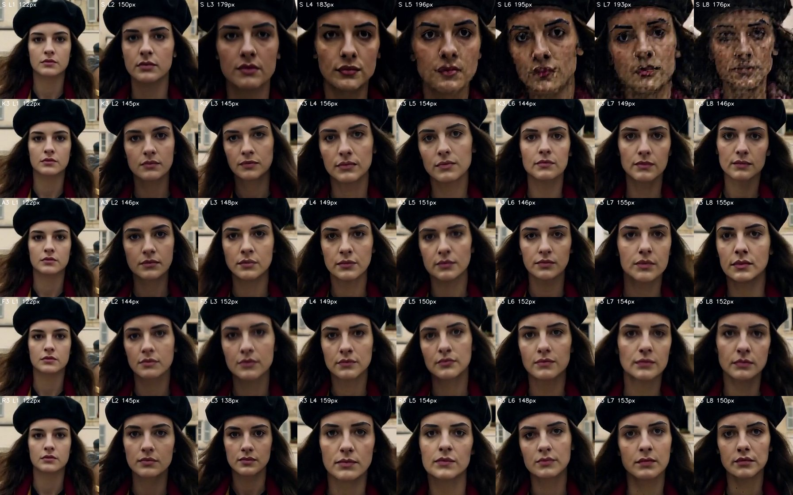
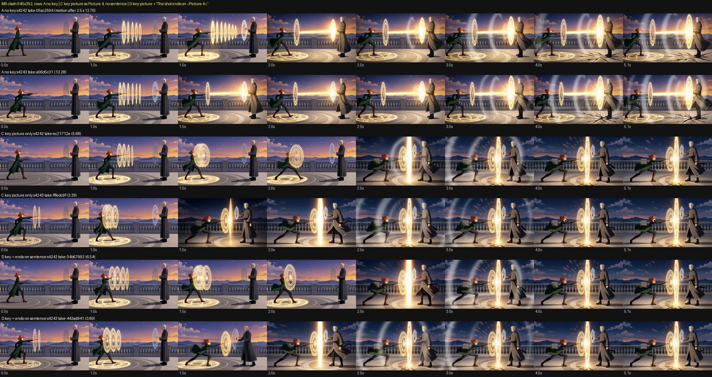
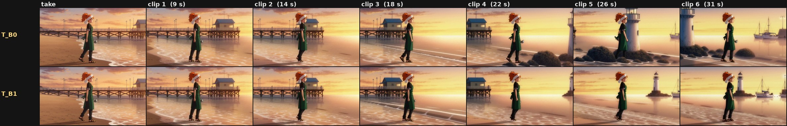

# H3 long-video research

Open lab notes on making MiniMax H3 / Pika H3 Flex video **longer and more consistent**: extending a clip past a minute without it falling apart, keeping a character and a place the same across cuts, and references that update as a shot travels instead of pulling it back to where it started.

By Dylan ([matlowai](https://github.com/matlowai)) with Claude agents, November 2026. Measured on one or two RTX 5090s with MiniMax H3 int8 checkpoints and the Pika H3 Flex LoRAs (6-step), mostly at 832x480, 640x352 and 1280x704. Most cells are one or two seeds: read counts as k of n, and check the caveats in each study before relying on a number.

> Dylan, 2026-11-07: "all the learnings around let's make videos extend better and have better context extension and be able to update latent references as we go should be public research"

## Key findings

**Extending a clip (latent carry), [studies/u46_extend.md](studies/u46_extend.md)**

1. **Carry the sampler latent, don't re-encode the decoded tail.** The decode + VAE re-encode chain causes the colour creep: saturation 1.42 → 1.10 over 3 segments, and a peak of 1.58 → 1.16 over 8 segments (35.6 s) with the latent carried instead. It is also faster per segment (~28-31 s vs ~40 s at 832x480).
2. **The Anti-Burn LoRA doesn't pay on a latent carry up to 35 s.** There is almost no burn left to cancel, and it softens: detail ratio 0.59 vs 1.41 on the moving scene.
3. **A plain latent carry holds about 40 s, then grows a mosaic texture.** On a 2-minute looping test, detail rises to 1.63x by ~91 s and a face falls to ArcFace 0.31 against the first loop ("different person" is about 0.35). The re-encode chain fails by ~25 s (detail 9.2x).
4. **Re-anchoring is enough, the rest of the protection bundle isn't needed.** A keystone + capstone re-anchor to the first clip every 3rd clip ("Long K3") holds the full 2 minutes: detail 1.07, Lab drift 1.1, ArcFace 0.75-0.85 on a face close-up, at no extra cost per segment. Late Lock doesn't help (detail 1.42). The full bundle keeps the face but darkens hair by 19 L* and changes the world on a moving shot.
5. **The audio drone comes from the audio carry, not the picture.** Long chains grow a sustained harmonic drone (6-9 of 24 segments, tagged "music / violin" by an AudioSet model). Generating fresh audio on each re-anchor clip takes it to 0/24 on both test scenes, and the picture doesn't change.

**References and prompts, [studies/prompt_craft_rules.md](studies/prompt_craft_rules.md)**

6. **A picture in the references is a target.** A key ("peak") picture on an action cut makes the take morph into it by 1.5-2.5 s and freeze: 4/4 takes, motion 3.3-6.5 vs 12.7-13.3 without it, with or without a sentence. A cited location master is where takes cut to: 13/18 at 640x352 and 3/10 at 1280x704, against 0/3 without it. See also [studies/key_picture_freeze.md](studies/key_picture_freeze.md).
7. **Pictures beat words.** With a storyboard frame that showed two bowls, every wording kept two bowls (3/3). A clean one-bowl board drew one bowl 6/6, even with the bowl named four times in the prompt. Fix the picture before the prompt.
8. **The documented `<Subject N>` form is tidiness, not a lever.** Cast pictures defined as Subjects were neutral (same people, motion 12.2-13.5 either way). Wrapping a location master in a Subject did not stop takes cutting to it (2/6 vs 3/6).

**Models and design**

9. **FL2VA and Ref2VA are separate checkpoints with separate Pika adapters.** A continuation on the FL2VA pair can't carry reference pictures, so a Ref2V take extended that way silently changes model family and drops its pictures ([studies/factcheck_subject_vs_picture.md](studies/factcheck_subject_vs_picture.md), with sources).
10. **Design: world state, not memory.** Every reference gets a role and a lifetime: *who* (the Cast picture, permanent), *look* (permanent), *where* (rolling when the camera travels, fixed when it's locked), *what* (a prop or effect, only while the beat needs it) and *just before* (the latent carry). A ledger records what went into each segment and why. An extend director looks at each clip, decides by the shot's intent, guards before promoting a frame, and re-injects ([studies/world_state_design.md](studies/world_state_design.md), [studies/ideas_and_lessons.md](studies/ideas_and_lessons.md)).

## In progress / open

- **Rolling references in a long extend (U46h)** was still running at publish time: [studies/u46h_rolling_refs.md](studies/u46h_rolling_refs.md). It has the fact check, the arms (latent carry on FL2VA vs the same carry on Ref2VA with Subject references: none, Cast only, a fixed scene picture, a fixed set plate, a rolling set plate, agent-selected) and the director design, plus first strips by eye. **The verdict section is a placeholder until the lab finishes.** First look: with a fixed full-scene picture of the take, the starting pier comes back behind her at 31 s, the same reversion Dylan saw in a long beach walk.
- Not yet built: the reference ledger and the extend director ([studies/world_state_design.md](studies/world_state_design.md)).
- Still open: re-anchor periods other than 3 and 6; chains past 2 minutes; listening tests (audio verdicts rest on spectral features and an AudioSet tagger); more seeds and scenes; identity at face size for Cast-line placement; ending on a pose with a real last-frame input instead of a key picture.

## Contents

| Path | What |
|---|---|
| [studies/u46_extend.md](studies/u46_extend.md) | Extend studies U46, U46b-g: chain vs latent carry, Anti-Burn, 2-minute loops, re-anchor periods, face identity, the audio drone |
| [studies/u46h_rolling_refs.md](studies/u46h_rolling_refs.md) | Rolling references in extend (in progress) |
| [studies/prompt_craft_rules.md](studies/prompt_craft_rules.md) | Prompt and reference rules PC-01..17 with the measurements M1-M7 |
| [studies/key_picture_freeze.md](studies/key_picture_freeze.md) | Lab check: a key picture on an action cut jump-cuts and stalls |
| [studies/factcheck_subject_vs_picture.md](studies/factcheck_subject_vs_picture.md) | `<Subject N>` vs `<Picture N>`, FL2VA vs Ref2VA, and long-video papers, with sources |
| [studies/world_state_design.md](studies/world_state_design.md) | Design: references with roles, lifetimes and a ledger; the extend director |
| [studies/ideas_and_lessons.md](studies/ideas_and_lessons.md) | Research queue and synthesis lessons |
| [figures/](figures/) | Evidence strips and sheets (JPG) and three short silent clips; all metadata stripped |

Clips: [extend loop 6, Standard vs Long K3](figures/clips/extend_loop6_standard_vs_long_k3.mp4) · [key picture freeze, no key vs key](figures/clips/key_picture_freeze_no_key_vs_key.mp4) · [rolling refs, no pictures vs a fixed scene picture](figures/clips/rolling_refs_T_B0_vs_B2.mp4)

All people in the figures are generated original characters (Mio Hayase, Liora Venn, Corvin and unnamed test subjects).

## Related

- [ComfyUI-MAINodes](https://github.com/matlowai/ComfyUI-MAINodes): Dylan's MiniMax H3 ComfyUI nodes (render presets, `h3_extend`, Seam Normalize; the Snap front-end these studies were run for lives on its `snap` branch).
- [ComfyUI-Dials](https://github.com/matlowai/ComfyUI-Dials) and its [pages](https://matlowai.github.io/ComfyUI-Dials/): training-free steering dials for H3.
- [H3-Dials on Hugging Face](https://huggingface.co/MATLOWAI/H3-Dials): the published dial files.

## Credits

- **MiniMax** for [MiniMax H3](https://huggingface.co/MiniMaxAI/MiniMax-H3) and its prompt guides; **Pika** for [Pika H3 Flex](https://huggingface.co/Pika-Labs/Pika-H3-Flex).
- **roycho87** for the [Geiru Context Suite](https://github.com/roycho87/geiru_context_suite) (latent carry, Keystone, Late Lock, Context Noise), which the extend studies measure; it builds on **seitanism**'s [masked latent hold](https://github.com/seitanism/ComfyUI-H3-Motion-Context-MultiRef), **NikoDemon80**'s [Chain](https://github.com/NikoDemon80/ComfyUI-H3-Motion-Context) and drift measurements, **ethanfel**'s [context noise](https://github.com/ethanfel/ComfyUI-MiniMaxH3-Context-Loop) and **drozbay**'s [masked extension](https://github.com/drozbay/MaskVidExperiments).
- **Imagineer13** for the [H3 Anti-Burn LoRA](https://huggingface.co/Imagineer13/H3-Anti-Burn-LoRA).
- **kijai** for ComfyUI's MiniMax H3 support; **Kijai** and **ucren** for the FL2VA/Ref2VA notes quoted from the Banodoco Discord.
- **fredbliss** for the [review](https://github.com/fblissjr/ComfyUI-h3-explorations/blob/main/docs/wiki/references.md) that flagged the reference-pictures preset.
- The papers in the fact check (REEL, StateAgent, ATAS, "More Memory, Better Videos?", Keepsake, A²RD, Oneira and others) for the ideas behind the world-state design; links in [studies/factcheck_subject_vs_picture.md](studies/factcheck_subject_vs_picture.md).
- Measurement tools: SAM 3.1, ArcFace IR101, DINOv3, and the [AST AudioSet tagger](https://huggingface.co/MIT/ast-finetuned-audioset-10-10-0.4593).

## License

Text and figures: [CC BY 4.0](LICENSE). Please credit "Dylan (matlowai), h3-long-video-research".
