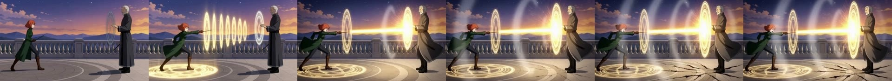
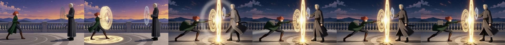
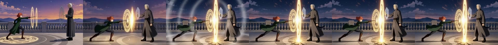

# A key picture on an action cut freezes the shot (lab check L8, 2026-11-07)

Lab note, 2026-11-07 18:50-18:53 EST, by Dylan (matlowai) and his Claude agents. One lab check from a larger pre-build round; the rest of that round was about Dylan's own tooling and is not published. The wider measurement (M6, the key picture vs the key sentence, two seeds each) is in [prompt_craft_rules.md](prompt_craft_rules.md).

## Question

A "key" picture is the beat's peak: a drawn storyboard frame of the moment the cut builds to. The design under test added it to an action cut's reference pictures with the sentence `<Picture 4> is the beat's peak (a key drawing): the cut builds to it and does not open on it.` The assumption was that this is harmless. It is not.

## Setup

- MiniMax H3 Ref2VA + Pika H3 Flex Ref2VA LoRA ("Pika + reference pictures", 6 steps), 640x352 (the clash shot at half size), 124 frames (5.17 s), seeds 4242 and 4243, no dial rows.
- The shot: a mage duel on an academy roof terrace (original characters Liora and Corvin), a beam clash. `<Picture 1>` = the opening board, `<Picture 2>` Liora's character sheet, `<Picture 3>` Corvin's character sheet: the same pictures and prompt as the clash's baseline recipe.
- **A (no key):** those three pictures only.
- **B (key hint):** the key board (the wide clash key) added as `<Picture 4>`, and the key sentence above appended to the first prompt line. Seed 4242, and a second seed 4243.
- **Measure:** mean absolute difference between consecutive frames at 320x176 RGB from 2.5 s on (motion). Calibrated first on earlier probe takes, which gave their numbers back: probe A s4242 10.78, with the key cited s4242 2.60, s4243 10.86 vs 2.63.

## Raw results

```
124 frames  mean frame change from 2.5 s: 12.70   0-2.5 s: 3.72   (A, no key, seed 4242)
124 frames  mean frame change from 2.5 s:  5.74   0-2.5 s: 6.04   (B, key hint, seed 4242)
124 frames  mean frame change from 2.5 s:  5.46   0-2.5 s: 7.92   (B, key hint, seed 4243)
calibration, earlier probe takes: probe_A_s4242 10.78 | probe_baseline_s4242 (key cited) 2.60 | probe_A_s4243 10.86 | probe_baseline_s4243 2.63
```

## Frames (6 per take at 0, 1.5, 2.5, 3.5, 4.5, 5.1 s)

A, no key, seed 4242:


B, key picture + sentence, seed 4242:


B, key picture + sentence, seed 4243:


Clip (no audio), A left, B seed 4242 right: [key_picture_freeze_no_key_vs_key.mp4](../figures/clips/key_picture_freeze_no_key_vs_key.mp4)

Read by eye: A stays in the opening wide framing (rings snap on, beam fires, ward grind, cracks) through the end. B changes at about 1.5 s: the sky goes from dusk to the key board's night palette and the framing moves closer to the key's two-figure composition (Corvin gets a hexagon ward, Liora a long lunge), and from there the frames hardly change (stalled), on both seeds.

## Verdict: the assumption was false

The key picture with the closing key sentence makes H3 jump-cut to the key's framing at about 1.5 s and stall: motion 5.5-5.7 against 12.7 with no key (the earlier "like <Picture 4>" probes gave 2.6). The jump is there on both seeds. This check did not separate the picture from the sentence; the follow-up measurement M6 did, and found the picture carries the freeze on its own (4/4 takes froze with or without a sentence; see [prompt_craft_rules.md](prompt_craft_rules.md), PC-06b and §8).

**Rule:** for an action cut (a cut whose beat is motion), do not put the key board in the reference pictures, and do not write a key sentence. Keep a key picture only for cuts that are meant to end on a held pose. Tie the rule to the cut's kind (action vs held), not just to whether a key exists: the hint is harmful even when the cut has a key, if the cut is an action clash.

Sample: one run per seed at 640x352, 3 takes. Strong but small.
