# Prompt-craft and consistency rules for H3-family video ("remember these things")

Rules for writing and checking prompts for MiniMax H3 / Pika H3 Flex video, with the evidence behind each. Written 2026-11-07, measured the same evening.
Status: rules §2 are corrected by the GPU measurements in §8; §0 is the current list. Open questions are in §7.
Rules are measured on Pika H3 Flex (Ref2V, 6-step turbo) at the stated resolutions (640x352 and 1280x704), with few seeds (usually 2-3 per arm): read every count as k of n, not as a rate.

**Why it exists.** Dylan, 2026-11-07 ~18:46: "this should be a harness change for the agentic stuff in terms of
prompting lessons, that referring to something by name too much can lean toward duplication... does Astrid have any
directives like this? does Snap? if not they need things like this for consistency check and prompting 'remember
these things'". Trigger: in the short "One More Bowl" (short05), cut C1 take 00227 drew two bowls; its prompt, compiled
automatically by Snap's story tool, names the bowl four times (two action clauses, a state line, the soundscape).

**Terms.** *Snap* is Dylan's ComfyUI front-end (part of the public ComfyUI-MAINodes pack); its story tool compiles a
cut's prompt from the beat, the blocking, state lines and Cast lines. A *Cast* is a character record: a reference
picture plus a one-line description. A *board* is the storyboard frame a cut opens on (cited as `<Picture 1>`). A
*master* is the location's master picture (the place, not this cut's framing). A *settei* is a character or item
reference sheet. A *key* is a picture of a beat's peak. The *critic* is an agent that reviews boards and takes. *Ref2V*
is reference-to-video (pictures in References); *FL2V* is first/last-frame-to-video. A *copy score* is an image
similarity of a frame against a picture (≥ 0.9 means a near copy). *Motion* is the mean frame-to-frame change.

**Evidence pictures made for this doc** (frames from existing takes):
- [c1_bowls_00192_vs_00227.jpg](../figures/prompt_craft/c1_bowls_00192_vs_00227.jpg): top, hand-written prompt (take
  00192, s7101); bottom, compiled prompt (take 00227, s7101); frames 0 / 48 / 72 / 88, crop of the counter.
- [end_cuts_land_on_master.jpg](../figures/prompt_craft/end_cuts_land_on_master.jpg): frame 104 of takes 00218, 00227,
  00228 and 00226 beside the ramen cart's location master: every end-of-take cut lands on the master picture's framing.

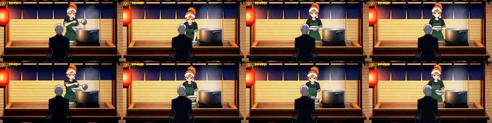

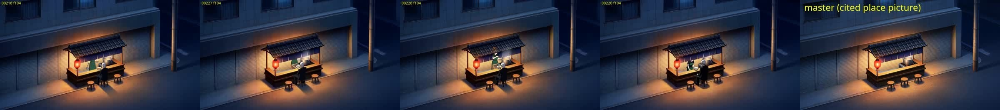

---

## 0. READ FIRST: the list after the measurements (2026-11-07 20:37)

The pre-measurement list was written before the GPU measurements (§8). They changed it: the board, not the wording,
made the duplicate bowl; a picture in References is what pulls a take, not its syntax. **Paste this list into a brief.**
Strength in brackets.

1. **Pictures beat words. Check every picture before video** (opening frame, storyboard, every reference): count each
   story prop and person against the beat; fix the picture, because no wording removes what a picture shows (old
   two-bowl board kept the bowl 3/3; clean board drew one bowl 6/6 even with the bowl named four times). [strong]
2. **A picture in References is a target.** A key/peak picture on an action cut: the take turns into it by 1.5-2.5 s and
   freezes (4/4, with or without a sentence; "the shot ends on <Picture n>" too). A location master: the take cuts to it
   (3/10 at 1280, 13/18 at 640; 0/3 without it). Leave out any picture whose framing you don't want reached;
   wrapping it in `<Subject N>` does not stop it (M7b). [strong]
3. **Continuity across a cut comes from pictures.** A continuing camera opens on the previous cut's out-frame (fixed
   short05 C1→C2). A new angle carries pose, props and timing in words and references, not the old image. [measured once
   + design]
4. **Write the action as one ordered sentence with its counts**; time a hit with a wind-up and "then" ("at the middle of
   the shot" put the hit at 0.9 s; the wind-up put it at 2.0 s). [2/2 cases]
5. **Anything you name gets drawn**, even as a measure ("a standing person's eye height" drew a man, 2/2). [2/2]
6. **No two lines may disagree** (hand, worn item, open/closed, position, facing): the model draws the wrong one. [2/2]
7. **To remove something a picture shows, edit the picture** (mask/region edit 2/2, words 0/4); otherwise say what is
   there instead. [measured]
8. **Seen from another side, name what holds** ("his head stays turned away", "the lens edge-on"); without it the head
   turned 5/6. [measured]
9. **Sound: lead with hard, countable events of the action** (clink, knock, footsteps); ambience-only wording renders
   near-silent; burst/impact beats bring booms and stings, so judge with sound on. [controlled 8-arm audio A/B; the
   train-vs-hiss "16 dB" claim is withdrawn]
10. **A voice reference goes only into cuts where that character speaks.** [measured, 2 shipped leaks]
11. **After every take:** count props and people every 0.5 s against the beat and board; score late frames against
    every cited picture (catches cuts and freezes, 0.92-0.99); listen with sound on. [checks worked as built]
12. **Two or three failed seeds of one recipe: change the pictures, the wording or the method, not the seed.**

**Demoted by the measurements (keep as tidiness only, no lint):** "name each prop once" (not a duplication fix);
"say what stays empty: no cars" (seed-specific; if written, never name the vehicle); `<Subject N>` wrapping (MiniMax's
guide wants it; measured neutral); bare vs name-joined Cast lines (no difference on a two-shot; identity untested).

---

## 2. The rules, one entry each

Each entry: the rule, the evidence, a before/after from our takes where one exists, the model families, how to check
it, and how strong the evidence is. The rules were written before §8; where §8 changed one, the entry says so at the
top. The evidence comes from three anime shorts and two sequences made with Snap's tools (short02, short03, short05 "One
More Bowl", seq01, seq02 "Nine-Ring Examination") and from earlier Snap studies.

Strength scale used below: **controlled** (same seed and setup, one thing changed), **paired** (same seed, more than
one thing changed), **counts** (k of n over seeds, one recipe), **single** (one take or one seed), **rule** (a
decision or a stated rule without a measurement).

Model names: *P-H3* = Pika H3 Flex video (turbo, 6 steps), *P-H3-Image* = Pika H3 image/edit, *Fizgig* = an H3 still
model, *MOSS* = MOSS Image.

### PC-01. Name each story prop once, with its count, in the sentence where it acts

> **After §8 (M1):** scoped down to tidiness. On a clean one-bowl board the four-mention prompt drew one bowl 2/2 (6/6
> over all wordings); on the old two-bowl board every wording kept two bowls (3/3). The board made the second bowl.

**Rule.** A prop the story moves (a bowl, a sword, a monocle, a letter) is introduced once, with an article and a
count or a telling word ("a white bowl", "exactly one sword"), in the action sentence. Every later mention is
definite ("the bowl") and only where the prop does something new; no state line restates where it is when the action
already says so, and no blocking line repeats the action ("ladles ... into a bowl" and "ladling broth into a bowl").

**Why (evidence).**
- *The trigger case, read from the frames.* The compiled prompt (take 00227, s7101, P-H3 turbo 6 steps) names the bowl
  four times: "Mio ladles steaming broth into a bowl ...", "Mio behind the counter centre, facing camera, ladling broth
  into a bowl", "The bowl is in Mio Hayase's hand.", and the soundscape "broth pouring into the bowl". Two bowls (one
  held, one on the counter) from f0 to at least f72 ([sheet](../figures/prompt_craft/c1_bowls_00192_vs_00227.jpg)). The
  sibling compiled take 00218 (s7101, same prompt minus the hold line) also holds two bowls f0-f72. Hand-written prompt
  (take 00192, the same seed 7101 and the same 6-step preset, an earlier board): "ladles steaming broth from the steel
  pot into a white bowl, pouring twice, then lifts the full bowl". It opens with the same two bowls (the board's), and
  by f72 she lifts one bowl and the counter is clear; its critic note says "the small second bowl on the counter from
  the board stays" (low). Preset C (take 00209, 30 steps cfg 5, same hand-written prompt): one bowl throughout; Dylan
  picked it "because it's clear and there's only 1 bowl, not a duplicate bowl". Dylan's own reading: "referring to
  something by name too much can lean toward duplication".
- *Where the second bowl was born.* The approved C1 board already shows a second small white bowl on the counter
  (critic low: "a second small white bowl already sits on the counter in front of Kuroe while she fills one"); its
  board prompt names the bowl twice ("Blocking: ... ladling broth into a bowl" and "... into a white ramen bowl held in
  her left hand"). The re-board took that board as context and kept both bowls. So repeated naming is in every prompt
  on the path that drew two bowls, and the board carried it.
- *Two swords, fixed by naming the end state once.* short03 C4: "greatsword strapped to her back" drew a second sword
  on her back (2 rounds); Fizgig C4 drew TWO swords 2/2 until the prompt said "the scabbard is now EMPTY, its open mouth
  with no hilt" (one sword 2/2; carried into seq01 as "exactly one sword: its blade inside the scabbard, only the hilt
  above her right shoulder").
- *Uniqueness said once works.* The JahJedi five-reference sheet prompt says each panel "appears ONCE" and "no second
  copy of the character inside a panel": clean 8-panel sheets 9/9.
- *A request the model can't draw comes back as a repeat.* "seen from above" in a one-sheet turnaround became a second
  back view (0/6 top views, 9/9 repeats).

**Where the repetition came from.** Snap's compile said the beat text, then the cut's blocking, then one sentence per
state field (including the prop's holder sentence "The bowl is in Mio Hayase's hand"), wrote the cut's sound line as
the soundscape, and appended each Cast line. Nothing merged a beat sentence and a blocking sentence that say the same
action, and nothing checked whether the action already placed the prop.

**Before / after (ours).**
- Before (compiled, two bowls): "Mio ladles steaming broth into a bowl while Baron Kuroe sits on the middle stool, arms
  crossed, waiting. Mio behind the counter centre, facing camera, ladling broth into a bowl; ... The bowl is in Mio
  Hayase's hand." / soundscape "the ladle clinking on the steel pot, broth pouring into the bowl, ..."
- After (hand-written, one bowl by f72 at 6 steps, one throughout at 30): "Mio Hayase (<Picture 3>), ..., stands behind
  the counter facing us and ladles steaming broth from the steel pot into a white bowl, pouring twice, then lifts the
  full bowl." / soundscape "the steel ladle clinking twice on the pot rim, broth splashing into the bowl, ..."

**Applies to.** H3 / P-H3 video (measured), Fizgig stills (swords), H3 sheets. Expected to hold for MOSS (untested).

**Check.**
- *Compile lint:* for each story prop, count the sentences that name its head noun. Lint when (a) the noun is
  introduced with "a/an" more than once, (b) a beat sentence and the blocking both carry the same verb + noun ("ladles
  ... bowl" / "ladling ... bowl"), (c) a holder sentence restates what the action already says. Suggested compile
  change: drop the holder sentence when the action already puts the prop with that holder, and merge a blocking clause
  that only repeats the beat.
- *Critic:* the prop count pass (§3 CC-1) on the board and on every sampled frame of the take.

**Strength.** Paired (same seed and preset; the prompts, the board and the reference order differ), two compiled takes
both doubled; the 30-step one-bowl take differs in preset. The clean A/B was run afterwards (§8 M1) and moved the cause
to the board. The sword fix is counts (2/2 vs 2/2).

### PC-02. One ordered action sentence; counts and timing inside it

**Rule.** The cut's action is one sentence in story order with its counts in it ("pouring twice, then lifts the full
bowl"). To land a hit or a peak at a time, write what comes before it (a wind-up, a circle, "then"), or give second
ranges; a place word ("at the middle of the shot") doesn't place it. A count word on a tonal sound isn't honoured
(see PC-13); a shape noun beats a count adjective ("one big classic anime sweat drop, a large clear teardrop shape").

**Why.**
- Bowl: the ordered one-sentence action is in both one-bowl takes (PC-01); in §8 M1 arm c (s7101) she lifts the full
  bowl at 3.5 s as written.
- Impact frame: v1 "lands one straight punch ... at the middle of the shot" hit at 0.9 s and froze; v2 "bounce lightly
  on their feet, fists raised, and circle half a step ... Then the man on the left lunges in and lands one straight
  punch" hit at 2.0 s (frame 48).
- Colour drain: "They circle one step, then both lunge and their blades cross and lock" locked at ~1.7 s as planned.
- Second ranges: "(1.5-3.5 s) ... full sphere", "(3.5-4 s) she sweeps the wand down" landed 3.0-3.8 s and 3.85 s;
  "(1.5-2 s) Her circle closes and fires" fired at 1.4 s.
- Count words: "a ship's horn sounding twice" came out as one held 4 s tone; "a single small drop of sweat" gave a thin
  line of sweat, "One big, classic anime sweat drop, a large clear teardrop shape" gave the drop.

**Before / after.** v1 "...lands one straight punch squarely into the other man's raised forearm guard at the middle of
the shot" → v2 "...bounce lightly on their feet, fists raised, and circle half a step, watching each other. Then the man
on the left lunges in and lands one straight punch squarely into the other man's raised forearm guard".

**Applies to.** H3 / P-H3 video (Pika 6 steps, T2V and Ref2V).

**Check.** Lint: a timing place-word ("at the middle", "halfway", "at the end of the shot") with no "then" or second
range in the same cut; two sentences of the description with the same main verb. Critic: the beat pass reads each
ordered verb against the frame times ("pours twice" = two pours).

**Strength.** Single seed per prompt (impact, colour drain, sweat drop); timing ranges single seeds within ~0.1-0.5 s.

### PC-03. Describe each person once, joined to their name and picture; only the people in the cut

> **After §8 (M5):** on a two-person two-shot, bare, name-joined and left-out Cast lines gave the same two people
> (2/2 seeds each, no swaps). Keep this as tidiness, not as an identity rule; identity at face size is untested.

**Rule.** Each person is described once, attached to the name and the picture that shows them: "Mio Hayase
(<Picture 3>), a 17-year-old girl ramen cook with ..." or "<Picture 2> is Liora: short copper hair, ...". No second
copy of the description, no description line without a name, and no Cast line of someone who isn't in this cut. When
a person must be pointed at (a recast, an edit), use a short positional description ("the girl in the long navy coat
at the railing"), not their whole details line.

**Why.**
- A Cast details line appended after the camera sentence means "a writer who already described the character gets the
  description twice, ... and with two Casts there's no telling whose sentence is whose" (dogfood finding).
- A later fix proposed naming each Cast in its sentence ("Mio Hayase (<Picture 3>), …"), but the video prompt did not
  do it: take 00227 still ends its description with two bare lines "a 17-year-old girl ramen cook ... a steel ladle in
  her right hand. a tall thin elderly gourmet critic ..." (the still prompt does name them).
- In a recast, the old Cast's whole details line used to point at her added a second girl beside the first 2/2; a short
  positional description replaced her 2/2.
- Leaked Cast lines draw the person: a character listed in the prompt but not in the shot was rendered between the two
  who were; Maren walked into C5 2/2, and two other characters into C6 2/2.
- Description once, picture first, works: the seq02 bake-off prompts describe each duelist once beside their picture
  and name them in the action; ~25 takes, no doubles, both on-model.
- A missing description draws the wrong body: a still prompt with no Cast words drew a boy character with a girl's
  body; hence "<name> is <Cast line>." on stills.

**Before / after.** Recast pointer: "15-year-old girl, short black bob … black boots" (added a second person, 2/2) →
"the girl in the long navy coat standing at the railing" (replaced her, 2/2).

**Applies to.** H3 / P-H3 video, recast (Viggle Remake swap), P-H3-Image and Fizgig stills.

**Check.** Lint: each Cast line's text occurs exactly once in the prompt and within the same sentence as its name;
any Cast line whose Cast is not in this cut is an error-level lint. Critic: people count (CC-2).

**Strength.** Counts for the recast and the leaks (2/2 each); the bare trailing line has not been shown to draw a double
on its own (§8 M5 found no difference).

### PC-04. Anything the prompt names gets drawn, even as a measure

**Rule.** Name only what should appear. A camera height is metres, not "a person's eye height"; a space is described by
its parts, not by who works there; a plate or master prompt names no person; a palette or light word stays out of a
shot where that light is off.

**Why.**
- "held at a standing person's eye height" put a man in the street 2/2; "a working space where a cook stands" put a cook
  and a customer in the cart 2/2 (short05, P-H3).
- "a gallery on <robot description>" put a small robot inside the lantern room (short02); location plates that name a
  character draw it.
- "teal and magenta neon glow" in the style line lit an unlit lantern teal → magenta in C05, C06, C07; dropping the
  palette words and "the lantern stays completely dark" fixed it 2/2 on the same seed.
- A colour word in a subject beat the style's palette 8/8; a colour-free subject held it (style scout).
- Palette words relight lamps, spin gravity is drawn as floating hair unless "normal gravity" is said (risk notes for
  seq02; rules without data).
- §8 M4: on the one seed that draws traffic, the sentence "no cars" came with a vehicle in 4 of 5 takes and 0 of 2
  without it; naming the vehicle may add it.

**Before / after.** short02 C05: style line with "teal and magenta neon glow" → the robot's lantern cycles teal/magenta;
re-take with the pier's style line and "the lantern stays completely dark" → lantern dark the whole clip.

**Applies to.** P-H3-Image, Fizgig, H3 / P-H3 video. **Check.** Lint: in plate, master and settei prompts, a person
noun (man, woman, cook, figure, people, customer) or a Cast name; in a cut, a colour word in a Cast line under a
limited palette. Critic: the scan pass's extra people (CC-2). **Strength.** Counts (2/2 each).

### PC-05. Pictures beat words: make the pictures agree with the beat first

> **After §8 (M1):** confirmed and made the top rule. The second bowl came from the board; no wording recovered it (0/3).

**Rule.** Before a video, every picture it cites (opening board, key, Cast pictures, states, plates) must agree with
the beat: the right count of each prop, the right hands, the right eyewear, the right seat. A disagreement is fixed in
the picture (an edit, a new state picture, a fixed Cast version), not argued with a sentence. A flaw in a board is a
flaw in every take made from it.

**Why.**
- The second bowl: born on the approved C1 board (critic low, approved because no note was high), carried by the
  re-board, present at f0 of all four C1 takes checked (00192, 00218, 00227, and the critic's note on 00192).
- The compile dropped the ladle, yet both key boards drew it from the context board; the ladle came back whenever the
  context board showed it.
- "the round gold monocle is off his right eye" 0/2: the identity picture showed it.
- New boards moved Kuroe to another stool despite "on the middle stool"; the render inherited it.
- Cast line "green coat", picture mustard coat: H3 drew mustard (three runs).
- The C2 spectacles came from the approved C2 board, so every re-board that kept it as context inherited them; the
  nose bar came from the Cast picture itself.
- A said-absent sentence helps a little when the context disagrees: without it 1/2 drew the ladle, with it 0/2. Keep
  the sentence, but don't rely on it.

**Applies to.** Every Ref2V video setup and every new-view / edit still. (FL2V reads no References: a `<Picture n>` in
an FL2V prompt points at nothing.)

**Check.** Critic: count story props and read hands/eyewear on every board before approval (§3 CC-3); a board
critic's prop-count note is at least medium because it spreads.

**Strength.** Counts across many cases (2/2, 0/2, 3 runs) plus §8 M1 (6/6 one bowl on the clean board, 3/3 two bowls
on the old one); the best-supported rule in the set.

### PC-06. Cite a picture only for its job; never as a look-alike, never another place

> **After §8 (M2, M7b):** confirmed at 640 and 1280. With the master cited, takes cut to it 13/18 at 640 and 3/10 at
> 1280; without it 0/3 at each size. Wrapping it in `<Subject N>` does not stop it.

**Rule.** Each `<Picture n>` sentence says what the picture is for: the opening ("The shot opens on <Picture 1>"),
this cut's camera, the place, who a person is, or a continuity frame ("is the same moment in the wide shot: keep its
light, colours and background"). Never cite a picture inside the action as something to look like ("a power clash like
<Picture 4>"), never cite the next or another place's picture, and know that any cited picture whose framing differs
from the cut's camera is a framing the take can cut or dissolve to.

**Why.**
- "(2-5 s) A power clash like <Picture 4>: ..." made Pika H3 Flex Ref2V jump into the key board's framing at ~2 s on
  2/2 seeds and stall (mean frame change 2.2 after 2.5 s); without the cite and with the motion written out ~10. Same
  prompt otherwise (both open with "The shot opens on <Picture 1>", which did not cut).
- The next place's plate as a reference made H3 hard-cut to it mid-take in 3 of 8 takes; a board tool whose default
  context was another place's board carried the same risk.
- The end-of-take cuts and dissolves of short05 v5 land exactly on the location master's framing. C1 00218 (f100), C1
  00227 (dissolve f97-f106), C1 00228 (cut ~f72) and C4 00226 (dissolve f71-f106) all end on the high three-quarter
  view of the master, the picture each prompt cites as "<Picture 3> shows the place (the same set, its buildings and
  layout), not this cut's framing" ([sheet](../figures/prompt_craft/end_cuts_land_on_master.jpg)). An earlier count
  found 3/11 Pika takes ending on "a dissolve or cut to a high wide of the cart": that high wide is the master.
- Same pull on stills: a P-H3 edit with an aerial master as Picture 2 takes the master's camera 2/2; the old still alone
  with the change in words kept eye level 2/2; "Wide, from inside the square" with the master as Picture 1 came back as
  the aerial 6/6; one wide plate as every shot's reference gave the wrong view 8/12.
- A continuity frame cited by its job did not cut: the seq02 round-3 insert's "<Picture 2> is the same moment in the
  wide shot ...; keep its light, colours and background" (3 takes, single seed).

**Before / after (Pika H3 Flex Ref2V, seeds 4242/4243).** Before: "(2-5 s) A power clash like <Picture 4>: Liora pours
everything in, teeth gritted, leaning into a deep lunge, ..." After: "(2-5 s) The beam and the ward grind against each
other: the clash point pulses brighter and swells, shock rings ripple out across the flagstones and cracks race
outward. Liora is driven back, her boots sliding a full step back across the stone, then she digs in ... Corvin's robe
whips back but his feet stay planted ... Neither falls; the clash holds. The camera does not move."

**Applies to.** H3 / P-H3 Ref2V video (measured), P-H3-Image and Fizgig stills (camera pull).

**Check.** Lint: `like|as in|similar to <Picture n>` inside a description sentence that also carries an action verb; a
location picture of another location than the cut's; on a cut with one camera, any cited place picture that is not the
camera plate (warning: "a take can cut to <Picture n>'s framing"). Critic: CC-4 (end-of-take cut detection by copy
score of late frames against every cited picture).

**Strength.** Look-alike cite paired (2 seeds; the cite and the motion wording changed together); next-place 3/8; the
master as cut target measured in §8 M2 (13/18 vs 0/3 at 640; 3/10 vs 0/3 at 1280).

### PC-06b. An action cut carries no key picture in References

> **After §8 (M6):** sharpened. The picture carries the jump; the sentence doesn't matter (4/4 jumps with no sentence
> or with "the shot ends on <Picture 4>").

**Rule.** A cut whose beat is motion (a clash, a burst, a pour, a walk) gets no key board in References: the motion is
written out in words (PC-02) and the cut opens on its board. Keep the key picture only for a cut where a ~2 s build
followed by a held near-still is what the cut wants. Say what was left out ("the key picture is left out of an action
cut: it makes H3 cut to its framing").

**Why.** Lab L8 ([key_picture_freeze.md](key_picture_freeze.md)): the seq02 round-2 clash recipe (Pika + reference
pictures, 6 steps, 640x352, 5.17 s, the opening board as <Picture 1>, both settei, no dials). Adding the clash key board
as <Picture 4> plus the sentence Snap's cut setup wrote for a key ("<Picture 4> is the beat's peak (a key drawing): the
cut builds to it and does not open on it.") made H3 switch to the key's night palette and closer two-figure framing at
~1.5 s and stall: mean frame change from 2.5 s on 5.74 (s4242) and 5.46 (s4243) against 12.70 without the key (s4242).
In the strip: dusk in the first two frames, night palette and a frozen lunge from 2.5 s to the end. It extends the
look-alike finding (the "like <Picture 4>" cite: 2.6 against ~10.8) from a cite inside the action to a closing key
hint. §8 M6 then showed the picture alone does it.

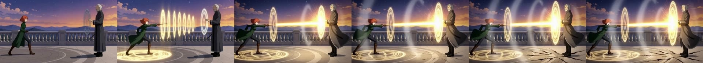

**Before / after (Pika H3 Flex Ref2V, seed 4242).** Before: References board + Liora + Corvin + the key board, prompt
ending "... Neither falls; the clash holds. The camera does not move. <Picture 4> is the beat's peak (a key drawing): the
cut builds to it and does not open on it." → jump at ~1.5 s, stall (5.74). After: the same without the key picture and the
sentence → the wide held, motion through the end (12.70).

**Applies to.** H3 / P-H3 Ref2V video (measured); by the same mechanism any cited picture whose framing differs from the
cut's camera (PC-06).

**Check.**
- *Cut setup:* when the cut has a key and its beat is an action, leave out the key picture and say so; lint "an action
  cut cites a key picture" when a person or agent adds it back. Tie it to the cut's kind, not only to whether a key
  exists.
- *Critic:* CC-4 names the destination of any jump ("cuts to Picture 4's framing at 1.5 s"); a motion stall after the
  jump (frame change well under the cut's own first seconds) is a beat note.

**Strength.** L8: paired over 2 seeds against 1 baseline (3 takes, low resolution), calibrated (the same measure gives
the look-alike numbers back). M6: 4/4 jumps against 0/2, 2 seeds per arm.

### PC-07. "One continuous shot" is not enough on its own

> **After §8 (M2c):** "put the hold line first" is refuted (2/3 cuts either way). Remove the picture it would cut to.

**Rule.** On a single-camera cut, say it once in plain words ("One continuous shot: the camera holds still on this
wide street view for the whole cut"), and also remove what it would cut to (PC-06). Expect it to fail sometimes; a trim
of the take is the fallback, and the critic flags it.

**Why.** "one continuous shot … no cut to another angle" held 1/2 (00227 dissolved at f97, 00228 cut at ~3 s); the
compiled prompt never says it. The 00227 critic suggested "re-roll with the hold-still line placed first in the
prompt"; there was no measurement of position until §8 M2c, which found none. The seq02 prompts end with "The camera
does not move." and held framing when no look-alike cite was present. Dials outrank the line: aura and arcane sigils
pushed the camera in despite "The camera holds steady" / "does not move".

**Applies to.** H3 / P-H3 video. **Check.** Critic CC-4. **Strength.** 1/2, single seeds; placement refuted (§8 M2c).

### PC-08. Say who is there and what stays empty

> **After §8 (M4):** the empty-street half is NOT CONFIRMED and is dropped. On the one seed that draws traffic the
> sentence came with a vehicle 4/5, without it 0/2. Keep the people-count sentence as tidiness; if you write an
> empty-street sentence, never name the vehicle.

**Rule (as first written).** Every multi-person shot says the count ("Only these two people", "Two people only"); a
wide shot of a street or room says what stays empty ("The street in front of the cart stays empty: no cars, no people
pass"). Use "no X" for things no picture shows; for something a picture shows, change the picture (PC-05, PC-10).

**Why (as first written).**
- C1 v5, compiled prompt without the empty-street line: a car with a driver drives through at f72 in 00218 (s7101) and
  a white sedan f62-f81 in 00219 (s7102, critic high). With the line ("The street in front of the cart stays empty: no
  cars, no people pass."): no car in 00227 (s7101) or 00228 (s7103) ("holds the wide street the whole take, nothing
  passes"). The hand-written prompt with "Only these two people." had no passer-by at 6 steps (00192). §8 M4 found this
  pair also changed the soundscape (a distant train vs a low hiss), so the cars may have come from the vehicle sound.
- Plates: "no figures" and "dry desert, no grass, no trees, no water" worked where a plate grew grass and a lake 2/2.
  The JahJedi sheet's closing negatives held 9/9.
- Where "no X" fails: "No people" with the aerial master as Picture 1 kept the aerial master (P-H3); a MOSS edit kept
  the people of Picture 1 under "No people". In both the picture showed them.

**Before / after.** Before (00218/00219): no line about the street → car 2/2. After (00227/00228): "... The street in
front of the cart stays empty: no cars, no people pass." → no car 2/2. Not reproduced in §8 M4.

**Applies to.** H3 / P-H3 video, P-H3-Image and Fizgig plates. H3 runs at cfg 1, so there is no negative-prompt input;
these words go in the positive text.

**Check.** Lint: a cut with two or more Cast and no count sentence (suggestion, never a block). No empty-street lint.
Critic CC-2. **Strength.** Original: paired (seed 7101 pair; the other pair differs by seed), 2 vs 2. Measured: not
confirmed (§8 M4).

### PC-09. No two lines may disagree

**Rule.** Hands, worn things, open/closed, position, facing and holder must agree across the beat text, the blocking,
the state lines, the Cast lines, any extra line and the board's role. The opening board must not carry the beat's
action verbs for a state the beat hasn't reached. Screen side and body side are said separately ("on the left of the
frame", "in her right hand").

**Why.**
- "Mio Hayase's right hand is empty" and "...a steel ladle in her right hand" in one prompt: the C2 board drew the ladle
  (critic high); "monocle off" and "a round gold monocle on his right eye" put it back.
- The opening board prompt kept "sets the full bowl down … with both hands" with "holds the ladle in the right hand"
  and drew the ladle in her hand; the key board drew it right.
- An extra line "The gate is still closed: both leaves shut" against the beat's "The gate leaves swing inward" drew the
  gate open 2/2.
- "green apron" and "<she> wears no apron" in one breath.
- C4 v5 boards, critic low: "the prompt says both 'monocle in his left hand' and 'hanging on his lapel'".
- Wand hand: "right hand" written three times still gave the wand in the left hand on 1/3 board seeds, in a prompt that
  also said "turned toward the right of frame".

**Applies to.** All. **Check.** Lint for disagreeing Cast/state lines and prop holders; add: two holder phrases for one
prop in one prompt ("in his left hand" and "on his lapel"); the beat's verbs in an opening still prompt for a field the
beat changes. **Strength.** Counts (2/2 several times).

### PC-10. To take something away, say what is there instead; words can't remove what a picture shows

**Rule.** A removal is written as what replaces it ("Where it was there is bare skin, nothing across the nose") and,
when a picture still shows the thing, done to the picture (a SAM mask removal, a region edit with an item settei as
Picture 2, or remove-the-whole-item-then-add-it-back). Describe an item by its shape and say what it is not ("a single
thin black vertical slit pupil like a cat's, no round pupil").

**Why.**
- Words over the nose bar 0/4; MOSS from words with a long negative 0/2; the same removal by SAM mask "the thin gold bar
  across the bridge of the nose:1" 2/2, 55x46 px changed; item settei as Picture 2 2/2; remove all eyewear then add the
  monocle back 2/2.
- "no arm over the ear" kept the arm 2/2 while the crop held the old arm.
- Slit pupils: "slit pupils" alone gave round ones; "Change only her eyes: gold irises, each with a single thin black
  vertical slit pupil like a cat's, no round pupil. Everything else stays." drew slits 3/3.
- Off states said literally: "the lantern head stays completely dark the whole time" fixed 2/2 on the same seed.
- "Clear, untinted glass" fixed the opaque lens: the opaque gold or yellow lens appeared in 10/10 C2 eyewear edits; "a
  lens of clear, untinted glass in a thin gold rim, his grey eye seen clearly through it" gave the one clean C3
  candidate (s9381, critic 0/0/0).

**Before / after.** "Take away the thin gold bar … across his nose" (0/4) → mask "the thin gold bar across the bridge of
the nose:1" with "Remove only the thin gold bar that runs across the bridge of his nose. Where it was there is bare skin,
nothing across the nose. His eyes, eyebrows, the round gold monocle lens on his right eye and its chain stay exactly as
they are." (2/2).

**Applies to.** P-H3-Image and Fizgig edits, MOSS stills; the "describe the shape" part to video too.
**Check.** Lint: "remove", "take away", "without" with no "instead"/"there is" clause in an edit prompt (suggestion).
Critic: the edit checklist ("only the asked change differs"). **Strength.** Counts (0/4 vs 2/2; 3/3).

### PC-11. Name what holds and the angle seen from this camera

**Rule.** When a change or an item is seen from another side than its reference, the prompt names what must not move
("his head stays turned away, back three-quarter to camera; his face stays hidden") and the item's look from this
camera ("the lens is seen nearly edge-on from behind: a narrow gold ellipse at the edge of his profile, not a round disc
facing the camera"). Direction words alone are weak against a picture's pose; check them.

**Why.**
- The four-part C2 recipe (region edit, a crop with the back of the head, the head's direction named, the item's angle
  named): "Each one was needed: dropping 2 or 3 turned the face (r1), and dropping 4 drew the lens face-on (r2)"; with
  all four 1/2 seeds clean.
- "Change only her eyes ..." without "her head stays in profile": 5/6 candidates turned the head.
- seq02 round-3 board: "in three-quarter view facing left" held 1/3; 2/3 turned to camera.

**Applies to.** P-H3-Image edits (measured); video by extension (untested). **Check.** Critic: "a worn item's angle
matches the head's turn". **Strength.** Counts (2/2, 5/6, 1/2).

### PC-12. Eyewear and small worn items: fix the picture, then say which side and what it is not

**Rule.** A monocle, a single earring, an eyepatch: the Cast picture must show it right (one lens, the right eye, the
chain) before any shot; the prompt says the side and what it is not ("one round gold monocle on his right eye only, on
a thin gold chain to his right lapel; no glasses, no second lens, no arm to the ear"). More steps do not help.

**Why.** Kuroe's front picture (s5201) drew round spectacles; boards C2/C3 turned the monocle into spectacles "even with
a clean monocle front picture"; "one round monocle on his right eye only, no glasses, no arm to the ear" plus a targeted
edit fixed boards 1/2 (2026-11-06 17:30). The bridge in every edit came from the Cast's own front picture; once Cast v5
removed it, no v5 video take showed a bar or spectacles (11 takes). The 20-step and 30-step presets drew spectacles or a
second lens on C4 where turbo drew a clean monocle.

**Applies to.** All H3 families and MOSS stills. **Check.** Critic Cast pass: colour line plus an eyewear line per
person per sampled frame ("monocle: right eye, one lens, chain to lapel"). **Strength.** Counts on boards (1/2), 11/11
video takes after the source fix.

### PC-13. Sound: hard, countable events first; nothing soft, steady or tonal; no stings; music N/A

> **After §8 (M3):** the lead rule stands (controlled audio study); the C1 "low hiss cost 16 dB" pair is withdrawn
> (not reproduced: all four tails within 3 dB). What moved loudness was on-screen action.

**Rule.** `overall_soundscape:` opens with the discrete sounds the action makes, hard ones first (a clink, a knock, a
thud, a scrape, footsteps), then at most a short ambience tail. Don't lead with soft, gentle, faint or distant; don't
use steady or tonal sources (hiss, hum, buzz, drone, rumble, horn, engine, cicadas); "loud" and "clearly audible" add
nothing. Ask for subtle diegetic sound: no stings, tada hits, clash bursts or game-style effects. `non_diegetic_music:
N/A` (music is a reference input). A prop in the soundscape is referred back to ("broth splashes into the bowl"), never
introduced again ("a bowl").

**Why.**
- Controlled audio study (8 arms, 2026-11-04): ambience-only "Soft ambient evening meadow: gentle wind ... faint
  birdsong" -57.8 dB mean; event soundscapes (fox bark, claws scratching, paws pattering) -39.1 to -42.1; "Clearly
  audible ... loud rustling" -56.0; seed, length and first frame moved it ≤ 2.6 dB.
- *Withdrawn after §8 M3.* short05 C1 v5, same seed 7101, same picture: the soundscape "the ladle clinking on the steel
  pot, broth pouring into the bowl, a distant train clacking over rails" rendered -35.3 dB mean (00218); swapping the
  train for "the gas burner's low hiss under the pot" rendered -51.3 dB (00227). The s7102/s7103 pair: -38.9 vs -54.1.
  The description also gained the hold lines and the motion differed (00218 opens on another angle and cuts); M3's
  controlled tails moved nothing.
- Soft events are quiet too: aura (breath, wind, pebbles, cloth) -45.2 LUFS and ink wash (sandals on gravel, rustle,
  wind, one hawk's cry) -54.7, against colour drain with "the two blades clashing once" -19.6 and impact with "one heavy
  thud" -29.6 (single seeds, not an A/B).
- Tonal words become drones: "a ship's horn sounding twice" one held 4 s tone; "humming/buzzing" grew a tone from ~9 s
  in a 34 s long take; same seed with "clicking and fizzing" no drone.
- Corny game SFX sink a take: short05 C3 option b was rejected for its sound (Dylan, 2026-11-06 21:10: "the corny game
  tada sounds are terrible for that lol some of the visual effects are good but the sound effects are bad"); and
  (21:13) "yeah if anything subtler sfx is generally preferred. music should be a reference input... sfx can be added in
  post". The burst beat is where they appear; the wording that produced option b is not recorded.
- "Impact words invite impact sounds": a music model (YuE2) given "taiko ... one low deep hit" gave trailer hits; the
  fix was a new wording, not more seeds.
- A named discrete crack inside "a continuous crackling roar of the clash" did not stand out: name the event, don't
  bury it in a steady bed.

**Before / after.** Audio study: "Soft ambient evening meadow: gentle wind through tall grass, rustling blades, distant
crickets and faint birdsong." (-57.8 dB) → "paws pattering on dry ground, grass crunching underfoot, a short fox bark, a
distant bird call" (-42.1).

**Applies to.** H3 / P-H3 with audio (Ref2V and FL2V); Viggle Remake keeps the source's sound ("The sound of <Video 1>,
unchanged."). **Check.** Lint: the soundscape's first clause contains soft/gentle/faint/distant or a tonal word; no
event verb in the first clause; a non-N/A music line. Don't lint the tail. Critic: a quiet note (< -45 dB), an AST
music/TV tag ≥ 0.30, a spectrum look for drones. **Strength.** Controlled (audio study), counts (drone A/B, same seed);
the C1 pair withdrawn.

### PC-14. Voices: the reference only where that character speaks; reference words never a script line

**Rule.** A Cast's `<Audio n>` goes into a cut only when that Cast has a line there; a cut where nobody speaks says so
and carries no voice reference. Record a voice reference on a line that is not in the script. Voice words (pitch, age,
sex) do nothing; the reference carries the timbre. Keep barks short; delivery words go before the line ("says it low
but clearly, close to camera", plan only).

**Why.** Maren's voice rode along as `<Audio 1>` in a cut that says "Nobody speaks"; H3 spoke her reference line
(found by Nemotron transcription). "the girl gasps once in the voice of <Audio 1> (..., no words)" spoke the
reference's words, so the short says her one line twice. A re-take put the voice back into a silent cut and it said
"One more bowl." H3 ignores pitch, age and sex words; casting words add nothing once the reference is cited. The
dialogue form used is `X says "..." in the voice of <Audio n>`; whether H3's `<d>` grammar delivers better is open.

**Applies to.** H3 / P-H3 Ref2V with audio references. **Check.** Voice only for speakers; lint reference words that
appear in the script; voice QA lists unscripted speech on every cut including silent ones. **Strength.** Counts (two
shipped leaks, Nemotron-verified).

### PC-15. Structure: style paragraph first, prose only, the three H3 sections

**Rule.** H3 video prompts have three lines: `integrated_multimodal_description: [Shot 1] ...`, `overall_soundscape:
...`, `non_diegetic_music: N/A`. The description opens with the production's 2-3 sentence style paragraph (no colour
words that a subject would take), then what we see in this order: the opening picture and framing, who (each once,
with picture), the ordered action, the camera sentence, the count sentence. Image models get prose, no capital headings
or `[TAG]` lines. Don't let an LLM expander rewrite a hand-made prompt. Combat beats need a target, a reaction and a
consequence and end on tension. Scale is drawn (reference pictures, low angle, wide lens), not worded.

**Why.** Style first (placement otherwise "a wash"; a colour word beat the palette 8/8); headings drawn as garbled
labels 4/4, prose 0/4; an LLM expander dropped "pocket-watch dial, anime line art"; the three sections are H3's prompt
format; on a combat prompt Dylan (2026-11-07 ~16:2x): "the dials are cool but that prompt is dumb... not very combat,
more like a skill display and then a lackluster plop to the ground :-D"; scale: walk cuts drew Maren 2.7-3.5 m tall
when the prompts said "eyes on the horizon" on plates 3-12 m up. **Applies to.** All. **Check.** Lint: headings or
`[...]` tags in an image prompt; a missing section. **Strength.** Counts (8/8, 4/4 vs 0/4); rules.

### PC-16. Check the dials before blaming the words

**Rule.** A dial (a learned steering direction applied at sampling time) can override a sentence (camera, pose, action,
sound). Before a wording fix, read the take's dial settings; judge a dialled take against its undialled baseline.

**Why.** Storm made Corvin lunge despite "his feet stay planted"; aura and arcane sigils pushed the camera in despite
"The camera holds steady" / "does not move"; storm added +3.4 LU and music-like tags under audio protect. Look dials at
k=2 under two reference pictures drew nothing. **Applies to.** H3 / P-H3 with dials. **Check.** The critic's packet
lists the take's dial settings. **Strength.** Counts per dial (single seeds, several dials).

### PC-17. Failed seeds mean a wrong recipe

**Rule.** Two or three failed seeds of one recipe stop it; step up: the wording, the pictures or the crop, the method,
the source record, a missing capability. Wording is the first rung, and the rules above say which wording to try.

**Why.** Rerolls kept a doubled wall; a new plate and the staging fixed it; the nose bar needed a mask, not seeds
(PC-10); the music model's taiko needed a new wording; seq02 round 1's combat prompt was fixed up the chain, not by
seeds. §8 M1 adds one more: no wording recovered a flawed board (0/3); the board is the rung to fix.
**Strength.** Rule plus several cases.

---

## 3. Consistency checks for the critic

Before this doc, Snap's critic scan pass named "duplicated people or objects" but defined a duplicate as "the same
person twice" and put only "duplicated, ghost or extra people" at high; the video cut checklist read 5 spread frames;
and the critic saw the beat, not the compiled prompt. The 00227 critic caught the ladle and the dissolve but not the
second bowl; the human-agent review missed it too. These checks found every cut and every second bowl in §8.

**CC-1. Story-prop count on every video take and every board.**
- Input: the prop list: each prop the cut moves, each item a Cast carries, each prop the beat text names, with the
  count the beat implies (one unless said) and its holder at the opening and at the end.
- Frames: every 12th frame (0.5 s at 24 fps) plus the first and last, whole at 100 %, and zoom tiles on the props.
- For each prop and frame: how many, where, held by whom. A second instance of a single story prop is **high** on a take
  (Dylan rejected 00227 for it) and **at least medium** on a board or any reference (it spreads to every take; the C1
  board's "low" second bowl reached four takes). A prop that changes holder off the beat, vanishes (the ladle "smears
  into two sticks", 00227 f40-46) or pops in is medium.
- Count against the board's own count too: a second bowl at frame 0 predicts it for the whole take (§8 M1).
- Output line per prop: `prop: bowl ×1 expected; f0-f72 ×2 (counter + her hands); f88 ×1`.

**CC-2. People and passers-by count per sampled frame.** Against who should be in the cut plus the prompt's count
sentence ("Only these two people"); a passer-by, a car with a driver or a duplicate is **high** (00219 sedan); a crowd
in a beat that asks for one is a finding; two villagers in the same dress are a crowd, not a duplicate.

**CC-3. Board against beat, and take against board.**
- Before a board is approved: CC-1 and CC-2 on the board, plus hands and eyewear against the opening or key state (the
  list of things said absent). An approved board with a prop-count note is an error to fix at source, not a low.
- Take against its board: the first frame's copy score against the board (Ref2V reads the board as a reference, not an
  exact first frame), the Cast positions and facing, each prop's count and holder. Say what changed: "the take opens
  closer than the board (copy 0.6)", "Kuroe moved to the right-hand stool".

**CC-4. End-of-take cut detection, with its destination.** Frame-to-frame change spike (a cut) or a cross-fade over
several frames (a dissolve), then the copy score of the frames after it against every cited picture: "the take
dissolves at f97 to Picture 3's framing (the master)". This names the picture to drop (PC-06) instead of leaving
"prompt ignored". Severity high when the cut is inside the cut's planned seconds; the fix line offers the trim point.
It also catches a key freeze (0.99 against the key, §8 M6).

**CC-5. The prompt that ran, beside the frames.** The critic gets the executed prompt, its prop list with counts and
holders, the count sentence, the dial settings and the said-absent list, so the beat pass reads verbs, counts and
negations against the frames and can mark an owner "prompt" with the sentence that caused it.

**CC-6. Contradiction self-check before the GPU.** The compile's contradiction lint (PC-09) is read and settled before
the run; a still-open contradiction is said in the run plan (a note, never a block).

**CC-7. Sound with the picture.** Every pick is judged with sound on: the quiet note (< -45 dB), an AST music/TV tag
≥ 0.30 (flags stings and music), a spectrum look for drones, and the voice QA's unscripted-speech list on every cut
including silent ones.

**CC-8. Cast colour and eyewear lines in every sampled frame**, inside flashes and bursts too, plus "a worn item's angle
matches the head's turn".

Fixture note: a reading rule added to a critic should ship only after a fixture set confirms it doesn't lose what the
critic already catches. Candidate fixtures from this doc: 00227 (two bowls + ladle-to-sticks + dissolve to the master),
00219 (a sedan through a wide), the approved C1 board (second bowl), 00228 (cut to the master at ~3 s).

---

## 4. Where these rules belong in a tool

The original section drafted rule entries for Snap. The general point: each rule here lands in up to three places, and
it is worth putting it in all that apply. (1) The prompt compiler and its lint: say a prop once, join each Cast line to
its name, leave a key picture out of an action cut and a location master out of a one-camera cut (and say so), lead the
soundscape with events. (2) A short note an agent reads before writing a prompt (the §0 list). (3) The critic: count
props and people every 0.5 s, name each cut's destination picture, listen with sound on. After §8, the compile-side
rules worth enforcing are the picture rules (key out of action cuts, master out of one-camera cuts); the wording rules
(name once, empty street, bare Cast lines) are tidiness without a measured failure to catch.

---

## 5. For Astrid (portable)

> **Prompt-writing and consistency rules we use for generative image/video (H3-family video models, edit and still
> models).** Built from our own takes and measurements; each line has a measured case behind it. Dylan asked whether
> Astrid's generation packs carry anything like this; offering it in case it helps your agents.
>
> Writing a prompt
> 1. Name each prop once, with its count, in the sentence where it acts ("a white bowl"); afterwards say "the bowl". A
>    prompt that introduced the same bowl in the action, the blocking and a separate "the bowl is in her hand" line drew
>    two bowls in both takes; one ordered sentence drew one.
> 2. Write the action as one ordered sentence with counts ("pours twice, then lifts the full bowl"). To land a hit at a
>    time, write the wind-up before it ("they circle; then he lunges"): "at the middle of the shot" put the hit at 0.9 s,
>    the wind-up put it at 2.0 s.
> 3. Describe each person once, attached to their name and their reference picture. A long description used to point at
>    a person in an edit added a second person (2/2); a short positional one ("the girl in the navy coat at the railing")
>    worked (2/2). A description of someone not in the shot puts them in it.
> 4. Whatever the prompt names gets drawn, even as a measure: "a standing person's eye height" drew a man (2/2). Give
>    heights in metres, describe spaces by their parts, keep colour words out of shots where a light must stay off.
> 5. Reference pictures beat words. A prop, a seat or eyewear in a reference comes back whatever the text says (many
>    cases, 2/2 each). Make the references agree with the shot before rendering; a flaw in a storyboard frame shows up in
>    every take made from it.
> 6. Cite a reference picture only for its role (opening frame, camera, place, who someone is, a continuity frame). "Like
>    <Picture 4>" inside the action made the video jump-cut into that picture's framing (2/2); a "this is the peak the
>    shot builds to" picture on an action shot did the same and stalled the motion (2/2, less than half the motion); a
>    picture of the next location made it hard-cut there (3/8); end-of-take dissolves we saw all landed on the framing
>    of the place picture we had cited. Write the motion out instead.
> 7. "One continuous shot, no cut" helps but held only 1/2 on its own; remove the picture a take would cut to.
> 8. Say how many people there are and what stays empty ("the street stays empty: no cars, no people pass": 0/2 cars,
>    against 2/2 without). "No X" works for things no reference shows; it does not remove what a reference shows.
> 9. No two lines may disagree (an empty hand vs a ladle in that hand; "gate closed" vs "the gate swings inward"): the
>    model draws the wrong one (2/2).
> 10. To remove something, write what is there instead ("bare skin, nothing across the nose"); if a reference shows it,
>     mask it or edit the picture (words 0/4, mask 2/2). Describe a shape and what it is not ("a single thin vertical
>     slit pupil, no round pupil": 3/3; "slit pupils" alone failed).
> 11. When a change is seen from another side, say what holds ("his head stays turned away") and how the item looks from
>     this camera ("the lens seen edge-on"); without them the head turned (5/6) or the lens faced the camera.
> 12. Sound: open the soundscape with hard, countable events the action makes (clink, knock, thud, footsteps). Ambience
>     or soft words render near-silent (about -57 dB against -39 to -42 dB with events; "loud" changes nothing); swapping
>     one hard event for "a low hiss" cost 16 dB. Tonal words (horn, hum, buzz) become drones. Ask for subtle, diegetic
>     sound: stings, "tada" hits and clash bursts sink a take. Music comes from a reference input, not the take.
> 13. A voice reference goes only into shots where that character speaks; the model speaks the reference's own words in
>     silent shots. Record references on lines that are not in the script.
>
> Checking a take (a consistency pass)
> 14. Count every story prop and every person in frames every half second, against the shot's beat and its storyboard
>     frame, before arguing framing. A duplicated prop is serious on a take and on a storyboard frame alike (it spreads).
> 15. Find cuts and dissolves inside a take and say which reference picture they land on.
> 16. Listen with sound on; flag stings, music-like tags, drones and unscripted speech.
> 17. Two or three failed seeds of one recipe means change the wording, the references or the method, not the seed.

**Corrections from §8 to the portable list above** (it was written before the measurements): item 1's two bowls came
from the storyboard frame, not the naming (on a clean frame the four-mention prompt drew one bowl 2/2; on the flawed
frame no wording recovered, 0/3). Item 6: a key picture is reached by ~2 s and frozen whether or not any sentence cites
it (4/4); a location master cited as a reference is where takes cut (13/18 at 640, 3/10 at 1280, 0/3 without it), and
wrapping it in `<Subject N>` does not stop that. Item 7: putting the hold line first changes nothing. Item 8's
empty-street half did not reproduce (on the seed that draws traffic, 4/5 with the sentence, 0/2 without); don't name
vehicles. Item 12's "16 dB" pair did not reproduce (all tails within 3 dB); the lead-with-events rule stands.

---

## 6. Where earlier lessons overstated or strained

The original section listed conflicts with Snap's own rules and lessons. The generally useful points:

- A lesson that blamed the duplicate bowl on the prompt naming it several times overstated the cause: the second bowl
  was born on an approved storyboard frame (critic note "low") and carried by the re-board; §8 M1 confirmed it. Fix
  the picture at source; read the frames before writing the lesson.
- A board approval gate that passes anything without a "high" note lets a prop-count flaw through. Boards are
  references, and a flaw in a reference spreads to every cut that cites it: a duplicated prop on a board needs at least
  medium severity.
- "End on a picture by citing it as a reference ('the shot ends on <Picture 2>')" is wrong for any cut longer than about
  2 s: the take reaches the picture by ~2 s and holds it as a near still (§8 M6).
- "No negative prompt" at cfg 1 is about the negative-prompt input. "No people" inside the positive text works for
  things no picture shows; it cannot remove what a picture shows.
- Dylan picked a 30-step take for one bowl, while Pika at 6 steps is his stated quality standard. With a clean
  one-bowl board, 6 steps drew one bowl 6/6 (§8 M1), so the fix was the board, not the steps.
- A critic's "re-roll with the hold-still line placed first" had no evidence; §8 M2c measured it and found no effect.
  The destination evidence (CC-4) points at the cited picture instead.

---

## 7. Open measurements that would settle the weak rules

As planned before §8; status after the measurements in brackets.

- **M1 (PC-01, the clean bowl A/B).** short05 C1, Pika 6 steps, seeds 7101/7102/7103, the same references with a clean
  one-bowl board: (a) the compiled prompt as is, (b) the same with the holder line and the repeated blocking clause
  removed, (c) the hand-written ordered sentence. Count bowls per 0.5 s (CC-1). [Done, plus old-board arms: §8 M1.]
- **M2 (PC-06/07, the cut target).** C1 v5 recipe at s7101-s7103, 4.46 s: (a) as is, (b) without the master picture,
  (c) with the master but the hold line first. Count takes that cut, and where to (CC-4). Also settles whether "placed
  first" matters. [Done at 640 and 1280: §8 M2.]
- **M3 (PC-13, soundscape tail).** One cut, three soundscapes on the same seed: events only, events + a short ambience
  tail, events + "a low hiss". Mean dB and AST tags. [Done at 640 with a fourth arm: §8 M3.]
- **M4 (PC-08, empty street).** The C1 recipe at three seeds with and without the empty-street sentence; count cars and
  passers-by. [Done at 640 and 1280: §8 M4.]
- **M5 (PC-03, the bare Cast line).** A two-person cut with the Cast lines (a) appended bare, (b) joined to names, (c)
  left out (pictures only); people count per frame over the seeds. [Done on a two-shot: §8 M5. Still open: a close-up
  two-shot where faces are judgeable.]
- **M6 (PC-06b, picture or sentence).** L8's clash recipe at s4242/s4243: the key picture in References without the
  "beat's peak" sentence, and "the shot ends on <Picture 4>" in its place. [Done: §8 M6.]

Still open after §8: identity effects of Cast-line placement or `<Subject N>` wrapping at face size; whether wording
helps a take recover a flawed board when the flaw is not a whole prop; the soundscape tail at 1280.

---

## 8. Measurements (2026-11-07)

Run in Snap with its own tools only (recipe setup, references, settings, shots, runs and edits), in two new scenes;
no short05 or seq02 shot was opened for editing. Take labels below are the output file numbers.

Measures:
- motion = the lab L8 measure: mean frame change at 320x176 from 2.5 s;
- cut / dissolve with its destination (CC-4): the frame leaves frame 0's framing (normalised correlation of a blurred
  64x36 grey frame < 0.8), and the frames after it are scored against every cited picture. A score ≥ 0.9 means a near
  copy of that picture. Calibrated on v5: 00227 → master 0.92 from f98 and 00228 → master 0.95 from f64, as the critic
  and PC-06 said; the 00219 sedan shows as "away and back";
- loudness = ffmpeg volumedetect mean dB + EBU R128 integrated LUFS;
- AST AudioSet tags on the CPU, 2 s windows, hop 1 s;
- counts by eye from 0.5 s strips: props from a counter crop at 1280, people and cars from whole frames.

Per-take JSON and per-seed strips are not published; the summary strips are linked below.

**Status 19:50: paused for a re-make of short05 C2.** Twelve queued runs were taken out of the queue unstarted (listed
under "To resume"). 26 C1 takes + 6 M6 takes + 2 board candidates landed. The runs resumed at 20:31 ("Measurements
continued" below).

### M6 (PC-06b): the key picture or the key sentence? DONE

Arms: the L8 clash recipe (Pika + reference pictures, 6 steps, 640x352, 124 frames; Picture 1 the opening board,
Picture 2 Liora settei, Picture 3 Corvin settei; no dials), seeds 4242/4243.
- **A** no key: 00314 (s4242), 00315 (s4243).
- **C** the key board as Picture 4 in References and **no sentence** (prompt identical to A): 00316 (s4242), 00317
  (s4243).
- **D** the key as Picture 4 plus "The shot ends on <Picture 4>." after "The camera does not move.": 00318 (s4242),
  00319 (s4243).

| arm | seed | motion after 2.5 s | 0-2.5 s | key copy score ≥ 0.85 from | key score at the end | LUFS |
|---|---|---|---|---|---|---|
| A no key | 4242 | **12.70** | 3.72 | never (max 0.51) | 0.43 | -22.1 |
| A no key | 4243 | **13.28** | 5.18 | never (max 0.46) | 0.42 | -22.3 |
| C key picture, no sentence | 4242 | **5.68** | 6.18 | 2.5 s (f60) | 0.99 | -22.8 |
| C key picture, no sentence | 4243 | **3.29** | 8.00 | 1.5 s (f36) | 0.99 | -22.2 |
| D key + "ends on <Picture 4>" | 4242 | **6.54** | 5.23 | 2.5 s (f60) | 0.99 | -22.8 |
| D key + "ends on <Picture 4>" | 4243 | **3.69** | 7.72 | 2.0 s (f48) | 0.99 | -21.8 |

Parity check: A s4242 gives 12.70, the same number L8 measured on another server, so the two setups agree.

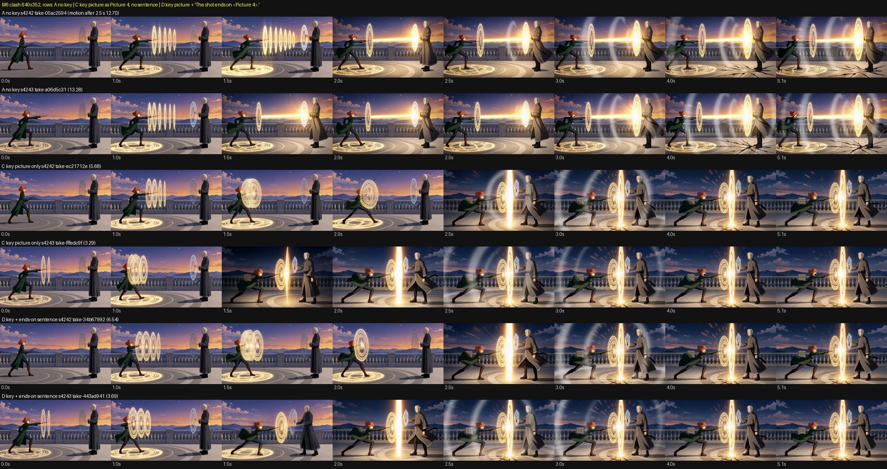

Strip rows A, A, C, C, D, D; 0-5.1 s; every row was looked at. In A, the rings snap on, the beam fires at about 1.4 s
and grinds against the ward, cracks spread, and the dusk wide holds to the end. In C and D, the rings build in the
wide, and then between 1.5 and 2.5 s the picture morphs into the key board itself: night palette, a vertical gold
pillar, the hexagon ward, the long lunge. From there it is a near still of the key (copy score 0.99) to the end. With
the sentence or without it, the look is the same.

**Verdict: PC-06b CONFIRMED and SHARPENED: the picture carries the jump; the sentence doesn't matter.** A key picture in
References on an action cut is reached at 1.5-2.5 s and then held as a near-still frame (2/2 seeds with no sentence, 2/2
with "ends on"; motion 3.3-6.5 against 12.7-13.3). "The shot ends on <Picture n>" does not delay the arrival to the end;
the take still arrives at about 2 s and freezes. So the advice to "end on a picture by citing it as a reference ('the
shot ends on <Picture 2>')" is wrong for any cut longer than about 2 s. It gives a held still from about 2 s, not an
ending. **Rule wording change:** PC-06b's "no key picture, and no key sentence" becomes "no key picture in References on
an action cut (the sentence is irrelevant: 4/4 jumps with no sentence or with 'ends on')". For held-pose cuts: the key
is reached by about 2 s and held, so keep the key picture only when a 2 s build followed by a hold is what the cut
wants. **Lint:** error-level "an action cut has a key board in References: H3 morphs into it by about 2 s and freezes"
(key on the picture, not on any sentence). **Critic:** CC-4's copy score against every cited picture finds this at once
(0.99 against the key).

### M1 (PC-01): the clean bowl A/B

First, a clean one-bowl C1 board made with Snap's edit tools: a P-H3-Image region edit with a SAM mask on the approved
board. Crop [0.469, 0.434, 0.137, 0.156], mask "the small white bowl on the counter:1", "Remove only the small white
bowl ... Where it was there is the bare wooden counter top ...", seeds 9161/9162. Both candidates changed only
x1065-1091, y576-607 (the second bowl); one was applied as the clean board. The bowl held at Mio's chest stays (the
critic's "floating bowl" medium is untouched).

Arms at 1280x704, 107 frames, Pika 6 steps, no upscale. The references are 00227's set with Picture 1 = the clean board.
- **a**: 00227's executed prompt, which names the bowl in four places: the beat, the blocking, the holder line and the
  soundscape. s7101 00323, s7102 00324.
- **b**: a with "The bowl is in Mio Hayase's hand." and the blocking's ", ladling broth into a bowl" removed. s7101
  00325, s7102 00326.
- **c**: b with the beat sentence replaced by "Mio ladles steaming broth from the steel pot into a white bowl, pouring
  twice, then lifts the full bowl, while Baron Kuroe sits ...". s7101 00327, s7102 00328.

CC-1 count from a counter crop every 0.5 s (rows a, a, b, b, c, c), bowl ×1 expected:

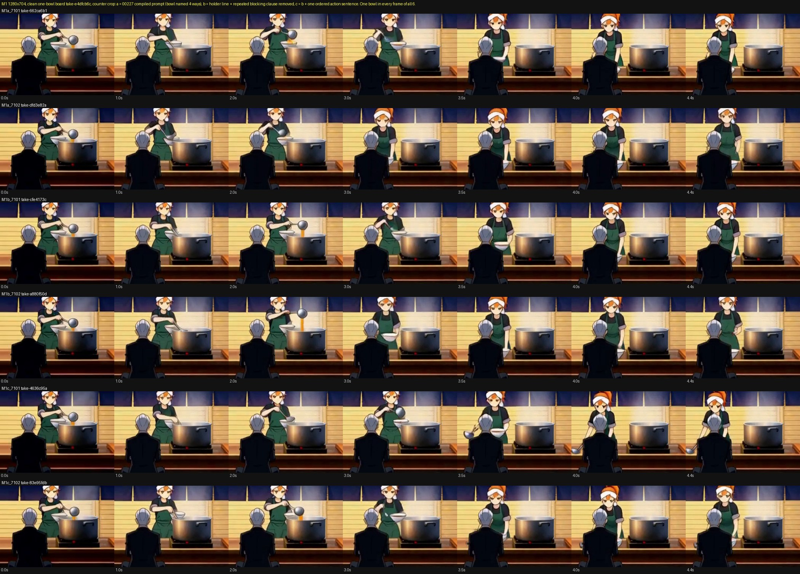

- **every one of the 6 takes has exactly one bowl in every sampled frame.** She fills the one held bowl at the pot,
  lowers it (a, b: about 3.0 s) or lifts it (c, s7101: at 3.5 s) and sets it down in front of Kuroe by 4.0 s.
- No take cuts or dissolves at 1280 (motion 0.16-0.23).
- Sound -48.8 to -52.7 dB, all arms alike. AST "Chink, clink" up to 0.46; no music, no burst.

**Verdict (first batch): PC-01 SCOPED: the board made the second bowl, not the repeated naming.** On a one-bowl board,
the compiled prompt that names the bowl four ways drew one bowl 2/2, the same as the trimmed and the ordered versions
(6/6 one bowl). The v5 doubling (00218, 00227: two bowls f0-f72) came from the approved board's second bowl. Repeated
naming did not create a prop on its own here. Open at the pause: whether wording helps a take recover when the board
has the flaw (arms d and e, answered below under "Measurements continued"). The one ordered sentence still earns its
place for the action (c's s7101 lifts the full bowl at 3.5 s as written); that is PC-02, not a count fix.

### M2 (PC-06/07): is the master picture the cut target? (640 in the first batch; 1280 below)

Arms at 640x352 on the clean board, s7101-7103.
- **T0**: 00227's prompt, the master cited as Picture 3. 00320, 00321, 00322.
- **M2b**: the master picture removed and its sentence removed; the later cites renumbered. 00332, 00333, 00334.
- **M2c**: the master kept, the "One continuous shot ..." line moved to the very start after "[Shot 1]". 00335, 00336,
  00337.

| arm | s7101 | s7102 | s7103 |
|---|---|---|---|
| T0 (master cited) | cut at 3.58 s → master 0.974 | cut at 2.33 s → master 0.971 | no cut (a car passes 1.4-3.0 s) |
| M2b (no master) | **no cut** | **no cut** | **no cut** (the same car 1.25-3.0 s) |
| M2c (hold line first) | cut at 3.58 s → master 0.972 | cut at 3.58 s → master 0.975 | no cut (the car again) |

Every end-of-take cut lands on the master: 0.97 against it, 0.2 against the board. Also at 640, M3's six takes and
M4off/M5b (all with the master cited) cut to the master at 2.3-3.75 s in 9 of 12. Together with T0 and M2c that is
**13 cuts to the master in 18 takes that cite it, against 0 in 3 that don't.** At 1280 the clean board held without a
cut in M1's 6 takes (s7101/7102, master cited). So the cut rate depends on size; the 1280 confirmation is below.

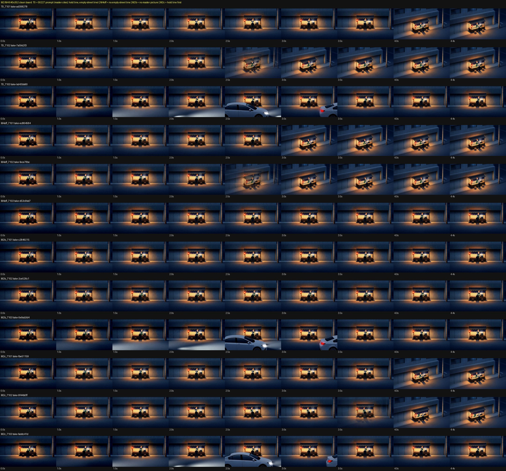

**Verdict: PC-06 CONFIRMED (the master picture is the cut target); PC-07's "placed first" REFUTED.** Moving the hold
line to the front changed nothing: 2/3 cuts as before, and s7102's cut moved from 2.33 to 3.58 s. Removing the master
picture removed every cut (0/3). **Lint/compile:** on a one-camera cut, leave the location master out of References by
default and say so ("the master is left out: takes cut to its framing"). The fallback is CC-4 naming the master as the
destination. No "put the hold line first" advice.

### M4 (PC-08): the empty-street sentence (640 in the first batch; 1280 below)

Arms at 640: T0 (with "The street in front of the cart stays empty: no cars, no people pass.") against **M4off**
(without it): 00329, 00330, 00331.

| arm | s7101 | s7102 | s7103 |
|---|---|---|---|
| T0 (sentence) | no car (cut to master 3.58 s) | no car (cut 2.33 s) | **white sedan 1.4-3.0 s** |
| M4off (no sentence) | no car (cut 2.67 s) | no car (cut 2.33 s) | no car, holds the whole take |

The s7103 sedan also came in M2b and M2c, which keep the sentence: **3/3 takes with the sentence at s7103 drew a car,
and 0/1 without it.** Two of the three seeds cut to the master before a car could pass, so at 640 the street was seen
for its whole length in only one pair.

**Verdict: PC-08's empty-street half NOT CONFIRMED (looks backwards at 640).** The v5 "with/without" pair it rested on
also changed the soundscape: the no-sentence takes 00218/00219 had "a distant train clacking over rails" and the
with-sentence takes had the hiss. So the v5 cars may have come from the vehicle sound, or from the sentence's own word
"cars" (PC-04: what you name gets drawn). **No lint for the empty-street sentence. As a hypothesis, if you must say it,
say it without naming the vehicle ("the street stays empty") and keep vehicle sounds out of the soundscape.**

### M3 (PC-13): the soundscape tail. 640 done

Arms at 640, s7101/7102, the soundscape only changed. The prefix is "the ladle clinking on the steel pot, broth pouring
into the bowl".
- events only;
- + "a quiet night-street ambience behind";
- + "the gas burner's low hiss under the pot" (= T0);
- + "a distant train clacking over rails".

| soundscape | s7101 mean dB / LUFS | s7102 |
|---|---|---|
| events only | -58.6 / -49.3 | -62.6 / -55.6 |
| + ambience tail | -57.5 / -48.6 | -61.2 / -53.7 |
| + low hiss (T0) | -58.6 / -51.5 | -61.1 / -53.7 |
| + distant train | -55.5 / -50.0 | -64.5 / -59.3 |

At this size and seed all four are within 3 dB, all quiet (< -45 dB). AST tops: crunch, frog, "sound effect"; no
music, no burst. No tonal drone tag from the hiss. **The loud takes at 640 were the ones where something happened on
screen:** T0 s7103 (car) -43.1, M2b s7103 (car) -41.3, M2c s7103 (car) -40.2. At 1280 the same soundscape gave -48.8 to
-52.7 (M1).

**Verdict: PC-13's "a low hiss cost 16 dB" NOT REPRODUCED; tail rule unchanged.** The short tail neither helps nor
hurts. Swapping the hiss for the train moved nothing. The v5 pair (-35.3 vs -51.3) changed the hold/empty lines and the
motion too (00218 opens on another angle and cuts). What moved loudness here was on-screen action, not the tail words.
Keep "lead with hard events; no soft or tonal words" (the controlled audio study stands). Drop the 00218/00227 pair as
evidence for the hiss. **Lint:** keep the soft/tonal first-clause lint. Don't lint the tail.

### M5 (PC-03): bare Cast lines (first batch: partial)

**M5b** (each Cast line joined to its name and picture; the bare lines removed) at 640: 00344, 00345. Two people in
every frame and no double. Both cut to the master like the other master-cited arms. **M5c** (lines left out) was taken
out for the pause. At 640 in this wide, both people are about 30 px tall, which is too small to judge identity or a
duplicate. Plan on resume: run M5 on a two-person medium (the seq02 clash two-shot recipe from M6 arm A, with Liora's and
Corvin's lines as (a) bare at the end, (b) joined, (c) left out; s4242/4243, 640). The figures are big there and the
recipe holds its framing without a key. (Done below.)

### To resume (taken out of the queue unstarted at 19:49)

- M1d: c on the old two-bowl board, s7101/7102.
- M1e: a on the old board, s7102.
- M1a at 1280, s7103.
- M2b at 1280, s7101-7103.
- M4off at 1280, s7101-7103.
- M5c, s7101/7102: superseded by the M5 two-shot plan above.

### Measurements continued (2026-11-07 20:31, same method)

The "To resume" list plus M5 on the two-shot plus M7 (the Subject wrapping), 22 takes, all with Snap's own tools.
The recipe was confirmed as Pika + reference pictures (Ref2V checkpoint + its adapter, 6 steps, lcm).

**M1d/M1e/M1a: does wording help when the board itself has two bowls? NO.** Old two-bowl board; counter crop every
0.5 s; frames at 0, 1.5, 3, 4.5 s enlarged.

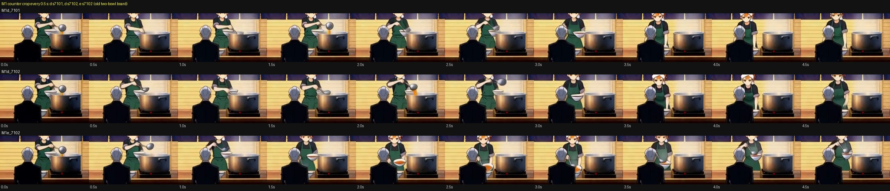

- d (ordered sentence, old board): s7101 00351, s7102 00352.
- e (compiled prompt, old board): s7102 00353.
- a on the clean board, s7103 00354.
- All three old-board takes keep the second bowl standing on the counter by Kuroe's shoulder at 0, 1.5, 3 and 4.5 s,
  next to the bowl Mio fills and lifts: two bowls for the whole take, ordered sentence or not (3/3). The clean-board take
  has one bowl until it cuts. Sound -49.8 to -53.6 dB, no music or burst; motion 0.15-0.19 (no cut).
- a s7103 (clean board) cuts to the master at 2.83 s (score 0.946): the 1280 cut is a master pull, not a bowl issue.

**Verdict: PC-01 SCOPED further: the board's flaw survives any wording (0/3 recovered); fix the board.** Lint/critic:
keep the CC-1 count against the board's own count (a second bowl at frame 0 predicts it for the whole take); lint
"board shows more of a prop than the story names" at the board, not in the prompt. No wording rule for it.

**M2b at 1280 (no master) and M4off at 1280 (no empty-street sentence).** Takes: M2b s7101-7103 00355, 00356, 00357;
M4off s7101-7103 00358, 00359, 00360. Strip rows: M2b x3, M4off x3, then M1a s7101-7103 (= master + sentence).

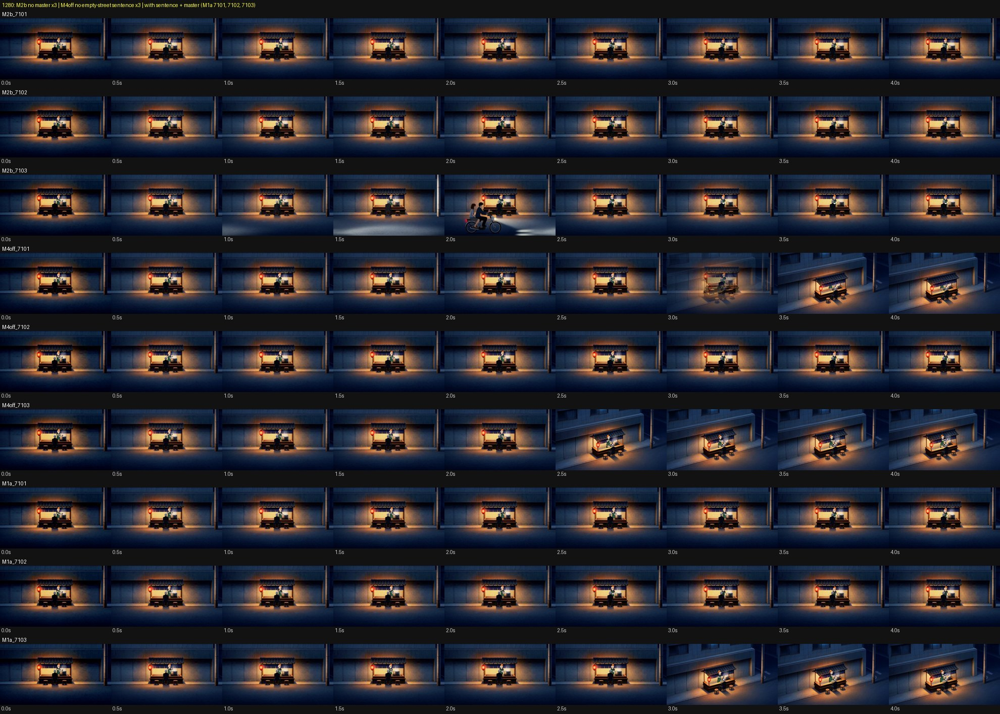

| 1280 arm | s7101 | s7102 | s7103 |
|---|---|---|---|
| master + sentence (M1a) | no cut, empty | no cut, empty | cut to master 2.83 s (0.946) |
| no master (M2b) | no cut, empty | no cut, empty | no cut; **a scooter with two riders crosses 1.0-2.3 s** |
| no sentence (M4off, master cited) | cut to master 3.08 s (0.974) | no cut, empty | cut to master 2.5 s (0.952) |

- Cuts to the master at 1280: 3 of 10 takes that cite it (M1a 1/3, M1b 0/2, M1c 0/2, M4off 2/3); 0 of 3 without it.
  The master is still the only place a cut goes (all 3 land on it). The effect is the same direction as 640 but much
  weaker at production size.
- Empty street: s7103 with the sentence drew a vehicle in 4 of 5 takes (T0, M2b, M2c at 640; M2b at 1280; M1a 1280
  cut at 2.8 s before one) and without it 0 of 2 (M4off 640, 1280). Seeds 7101/7102 never drew one either way. So the
  sentence does not keep the street empty, and on the one seed that draws traffic the naming may add it.
- Sound: -41.4 dB in the scooter take, -45.9 in M4off s7103, else -49.5 to -56.7: again the loud takes are the ones with
  something on screen.

**Verdicts: PC-06 CONFIRMED at 1280 with a smaller size (0/3 without the master; 3/10 with it). PC-08 empty-street
sentence: NOT CONFIRMED (0/3 takes with a street seen for its whole length drew traffic without it, 1 of 5 with it on the
seed that draws traffic; the sentence is not what keeps it empty).** Lint: master left out by default on a one-camera
cut stands (cheap, 0/3); no empty-street lint; if the sentence is written, never name vehicles in it.

**M5 (PC-03) on the two-person two-shot.** Recipe = M6 arm A (Picture 1 the opening board, 2 Liora settei, 3 Corvin
settei; 640x352, 124 frames, no key). Arms: (b) joined (the arm-A prompt as it is, "<Picture 2> is Liora on the left:
short copper hair, ..."), 00314/00315 (reused: same prompt, same seeds, parity checked in M6); (a) bare: the two
descriptions moved to the end as bare lines after "The camera does not move.": s4242 00361, s4243 00362; (c) left out:
"<Picture 2> is Liora on the left." only: s4242 00363, s4243 00364. Strip 0-5 s.

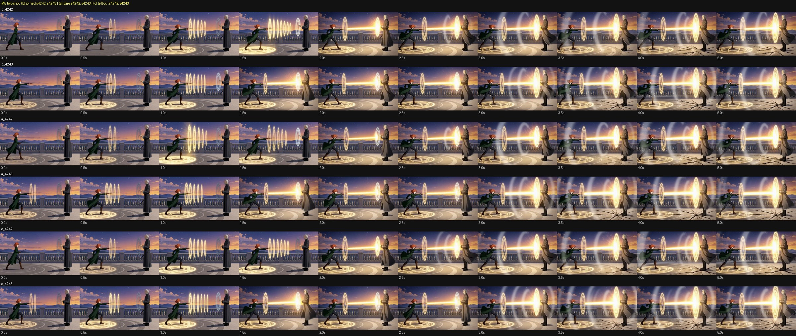

- People per frame: 2 in every sampled frame of all 6 takes. No duplicate person, no swap (Liora copper hair, green coat,
  wand, left; Corvin white hair, long robe, right, in every row), no extra figure.
- Motion after 2.5 s: b 12.70/13.28, a 14.09/15.18, c 12.52/15.70: no jump to a reference (late frames score 0.52-0.58
  against the board, never a copy), the same beat in all six.
- Honest limit: the figures are about 240 px tall in a 640 frame, so faces are not judgeable; costume, hair colour and
  silhouette hold in all six.

**Verdict: PC-03 NOT SEPARATED: bare, joined and left out gave the same two people on this recipe (2/2 seeds each, no
swaps).** With the pictures carrying the identity, the Cast text neither helped nor hurt. Do not write a bare-line lint
(there is no failure to catch); keep "describe each person once, with the picture" as a tidiness rule (no
double-describe), not an identity rule. Needs a close-up two-shot (faces) to say anything about identity.

**M7a (Cast as Subject, Ref2V path).** Same two-shot; Cast written as "<Subject 1> is Liora on the left, the young woman
in <Picture 2>, with short copper hair, ..." and "<Subject 2> is Master Corvin on the right, the man in <Picture 3>, ...",
opening frame still a standalone <Picture 1>. s4242 00365, s4243 00366, compared with the Picture form's 00314/00315.
See also [factcheck_subject_vs_picture.md](factcheck_subject_vs_picture.md).

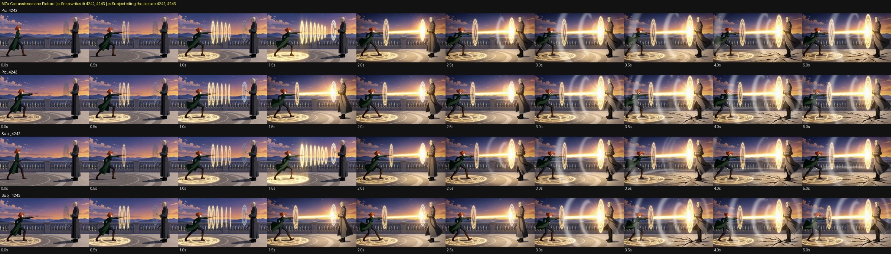

- Runs and renders: no error, no ignored syntax. Two people in every frame, same costumes, same layout, same beat.
- Motion after 2.5 s 12.20 / 13.45 (Picture form 12.70 / 13.28); no jump or freeze (late-frame scores against the cited
  pictures 0.53-0.56). Loudness -21.1 / -22.8 LUFS against -22.1 / -22.3.

**Verdict: Subject wrapping is accepted and NEUTRAL on this recipe (2/2): no better, no worse identity, count or
motion.** The evidence is too weak (small figures) to tell identity apart, so the official "define characters inside a
Subject" advice is not refuted, only not shown to matter here. Do not change how Cast is written on this evidence.

**M7b (the master cited inside a Subject).** C1 recipe with the master and the sentence, "<Picture 3> shows the place
(...), not this cut's framing." replaced by "<Subject 1> is the place in <Picture 3>: the same set, its buildings and
layout, not this cut's framing." 1280: s7101 00367, s7102 00368, s7103 00369; 640: s7101-7103 00370, 00371, 00372.
Strip with the Picture-form 640 T0 takes under it; the 1280 Picture-form takes are the M1a rows in the 1280 strip above.

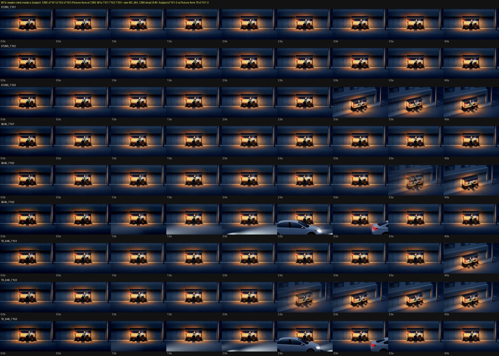

| | s7101 | s7102 | s7103 |
|---|---|---|---|
| 1280 Picture form (M1a) | no cut | no cut | cut to master 2.83 s |
| 1280 Subject form | no cut | no cut | **cut to master 2.88 s (0.949)** |
| 640 Picture form (T0) | cut to master 3.58 s | cut to master 2.33 s | no cut; white sedan 1.4-3.0 s |
| 640 Subject form | no cut | cut to master 3.42 s (0.979, dissolve) | no cut; white sedan 2.0-3.0 s |

**Verdict: wrapping the master in a Subject does NOT stop it acting as the cut target.** 1280 identical (1/3 and 1/3,
the same seed, the same time); 640 cuts 2/3 → 1/3 (not distinguishable from noise at n=3; the one that moved lost its
cut only on s7101, and the cut still lands on the master where it happens). The sedan on s7103 is also unchanged
(sentence kept). **Consequence:** the master stays out of References on a one-camera cut (M2b/M7b together: removal
0/6, wrapping 2/6 against 3/6). Do not offer the Subject wrapper as the fix; if the master is cited, CC-4 still names it
as the destination.

**Lint / critic consequences of this batch.** PC-01: no wording rule for a flawed board (check the board). PC-06:
master-out default confirmed at both sizes (smaller at 1280); the Subject wrapper is no remedy. PC-08: drop the
empty-street half entirely. PC-03: no identity claim from Cast-line placement; tidiness only. The PC-06b wording from
the first batch stands. No new critic checks: CC-1 (count against the board) and CC-4 (late frames against every cited
picture) found every cut and every second bowl above.
