# Extending MiniMax H3 clips: latent carry, re-anchors and audio (U46, U46b-g)

Lab notes, 2026-11-04 to 2026-11-05, by Dylan (matlowai) and his Claude agents. Model: MiniMax H3 FL2VA (int8 convrot) with the Pika H3 Flex FL2VA LoRA, 6-step LCM, mostly 832x480, one RTX 5090. One seed per cell unless stated; numbers are measured, readings by eye are marked as such. The methods tested are other people's work; these notes only measure them:
- [Geiru Context Suite](https://github.com/roycho87/geiru_context_suite) by roycho87: Geiru Context (the latent carry), Keystone/capstone, Late Lock, Context Noise. It builds on seitanism's [masked latent hold](https://github.com/seitanism/ComfyUI-H3-Motion-Context-MultiRef), NikoDemon80's [Chain](https://github.com/NikoDemon80/ComfyUI-H3-Motion-Context), ethanfel's [context noise](https://github.com/ethanfel/ComfyUI-MiniMaxH3-Context-Loop) and drozbay's [masked extension](https://github.com/drozbay/MaskVidExperiments); see its README for the full credits.
- [H3 Anti-Burn LoRA](https://huggingface.co/Imagineer13/H3-Anti-Burn-LoRA) by Imagineer13.
- From [ComfyUI-MAINodes](https://github.com/matlowai/ComfyUI-MAINodes): `h3_extend` = the masked VAE re-encode chain (decode the tail, re-encode it, prefix-freeze mask) and Seam Normalize = a colour fit over the held frames at each join.

| Study | Question | Answer in one line |
|---|---|---|
| U46 | Which extend method for ~14 s? | Plain chain is fine at 3 segments; Anti-Burn only softens; the Geiru bundle holds colour but resets the action. |
| U46b | Why does the chain drift in colour? | The per-segment decode + VAE re-encode. Carrying the sampler latent cuts saturation creep 1.42 -> 1.10 (3 seg) and 1.58 -> 1.16 peak (8 seg). |
| U46c | Ship it | Standard extend = latent carry from the take's last 39 frames + Seam Normalize, Anti-Burn off. |
| U46d | What happens at 2 minutes? | Standard decays after ~40 s (mosaic texture, detail 1.63x, smeared face by ~90 s); the re-encode chain fails by ~25 s; the Geiru bundle holds. |
| U46e | A cheaper middle? | Standard + keystone/capstone re-anchor to clip 1 every 3rd or 6th clip holds 2 minutes as well as the full bundle, at Standard's cost. Late Lock does not help. |
| U46f | Does the re-anchor keep a face? | Yes: K3/K6 ArcFace 0.75-0.85 to loop 1 through 2 minutes; Standard falls to 0.31; the full bundle darkens hair 19 L* and changes the world. |
| U46e audio, U46g | Why does the audio turn into a drone? | It is the audio carry (`hold_audio`), not the picture re-anchor. Generating fresh audio on each re-anchor clip (R3) gives 0/24 drone segments on both scenes with the picture unchanged. |

The method names used throughout: **S / Standard** = latent carry only; **G / Strong** = the full Geiru bundle (protection LoRA, context noise, keystone + capstone from clip 1, Late Lock); **R** = `h3_extend` re-encode chain; **K3 / K6** = Standard + keystone/capstone re-anchor every 3rd / 6th clip ("Long"); **L3** = K3 + Late Lock; **A3 / F3 / R3** = K3 with the audio head re-anchored to clip 1 / audio carry off on every clip / audio carry off on re-anchor clips only.

Sheet numbers refer to the original study's figure numbering; the published ones are linked into `../figures/extend/`.

---

# U46 - extend / long clip A/B (2026-11-04, 17:45-18:30)

## Verdict
- **Standard extend = plain Chain (h3_extend.py masked carry + Seam Normalize), Anti-Burn OFF at 3 segments (~14 s).** Anti-Burn 0.5 on segments 2+
  changed nothing we could measure at this length (colour, saturation, contrast, seams, audio all within noise of the plain chain) and made every
  one of 5 clips a little softer (Laplacian detail last/first second 0.64 vs 0.73 mean, lower in 5/5). The card's evidence is 10-clip (~37 s) chains;
  3 segments are too short to show burn. So: Anti-Burn is a slider that **defaults on only for long targets** (the card's ~6+ segments; the
  threshold is not measured here), greyed without the file, never on segment 1.
- **Strong = Geiru protection (context + keystone/capstone + Late Lock + context noise + Anti-Burn 0.5 on segments 2+).** It is the only arm that
  removes colour/saturation creep (Lab drift first vs last second 7.1 mean vs 15.1 plain; saturation ratio 0.98 vs 1.18). Cost: it pulls the shot back
  toward clip 1 (scene 1: the train pulling in is lost, DINOv3 layout vs frame 0 returns to 0.88 at the end where the plain chain stays at 0.59; the
  scene reads as a loop). So Strong is "hold the look", right for locked-off/static or long single-scene stretches, wrong where the action must keep
  evolving. The quality line should say so.
- **Surprise worth a follow-up:** the Geiru *latent* carry alone (arm d, no keystone/noise, + Anti-Burn 0.5) has no saturation creep (0.98 vs 1.18)
  while the h3_extend chain does (1.42/1.30 on the two moving scenes). Seam Normalize is not the cause (arm e, chain without it: 1.46/1.35/1.11 vs
  a 1.42/1.30/1.05). Likely cause (not tested): h3_extend re-encodes the decoded tail through the VAE for each segment, Geiru carries the sampled latent.
  If that holds, the cheap Standard improvement is a latent-carry variant of the chain, not a LoRA. Needs its own A/B (U46b).

## Setup
- 5 scenes x 4 arms = 20 clips (+3 control clips), 3 segments each, 345 frames = 14.375 s, 832x480, 6-step LCM, H3 FL2V int8 convrot + Pika Flex FL2V
  LoRA (the Dials Simple preset), no de-rope, no first frame, seeds 46000+100*scene (+segment). Same seeds/prompts across arms (segment 1 is identical across arms, DINOv3 0.61 to frame 0 in all four).
- Scenes: 1 woman in red coat, platform, tracking camera; 2 man in yellow raincoat, rainy neon alley, handheld follow; 3 woman cooking, locked off;
  4 fox cub in meadow, low tracking; 5 old fisherman mending a net, locked off. Every soundscape names discrete events (an earlier finding: H3 audio stays near-silent on ambience-only soundscapes). Segments 2/3 use a
  "shot continues without a cut" variant of the same prompt.
- Arms (one ComfyUI API prompt per clip, plain core + community nodes):
  - a: h3_extend chain, MASKED carry (Plan 141/39, Tail Context, tail + repeated last frame -> VAEEncode -> V2V Init with Prefix Freeze Mask, audio-only Add Guide, Trim, Seam Normalize channels).
  - b: a + Anti-Burn universal v1 at 0.5 on segments 2 and 3.
  - c: Geiru full: Geiru Context (head 39, drop_last 17, hold_audio, protection on, previous shot = the previous sampler output wired directly, no Save/Load Latent) -> Protection LoRA (Anti-Burn 0.5, never shot 1) -> Context Noise (1.0 linear) -> Keystone (front + capstone back, clip 1) -> Late Lock (swap step 3 of 6, capstone slot).
  - d: Geiru Context only (protection off) + a plain Anti-Burn 0.5 LoRA on segments 2+ (isolates the engine from keystone/noise).
  - e (control, scenes 1-3): a without Seam Normalize.
- Geiru segments are joined by ffmpeg per the Geiru README (previous minus last 17, next from frame 22): 124 + 102 + 119 = 345 frames, same length as the chain.
- Metrics: measured on 416x240 decoded frames. Drift = Lab distance first vs last second; saturation/contrast/detail ratios = last segment / first segment; seam spike = max frame-diff at the join (+-2 frames) / clip median frame-diff; audio step = dB RMS 0.25 s after vs before the join; hiccup = largest 100 ms level change within 0.3 s of the join / clip median change; DINOv3 = a DINOv3 copy score of one frame per second vs frame 0.
- Identity: not scored. ArcFace needs SAM face/hair masks (not run); judged from the sheets: face and hair stay the same person in all arms on scenes 1, 3, 5, in 2 only the back is visible. No arm broke identity. Scene 4 (fox) grows tiger-like stripes in every arm (a, b, c, d) - model drift on the prompt, not arm-specific.

## Numbers (mean of 5 scenes unless noted)
| | a chain | b chain + AB 0.5 | c Geiru full | d Geiru ctx + AB 0.5 |
|---|---|---|---|---|
| Lab drift, first vs last second | 15.1 (37 / 16 / 6 / 15 / 0.6) | 16.3 (38 / 16 / 8 / 19 / 0.8) | **7.1** (0.5 / 14 / 12 / 9 / 0.7) | 10.8 (15 / 15 / 10 / 13 / 0.4) |
| Saturation, last/first segment | 1.18 (1.42 / 1.30 / 1.05 / 1.03 / 1.09) | 1.18 | **0.98** | **0.98** |
| Contrast ratio | 0.88 | 0.87 | 0.90 | 0.85 |
| Detail (Laplacian var) last/first | 0.73 | 0.64 (lower in 5/5) | 0.71 | 0.63 |
| Seam frame-diff spike (2 joins, worst scene) | 2.1x | 2.4x | 2.4x | 2.0x |
| Audio level step at joins (worst, dB) | 15.1 (scene 3), else <= 6.6 | 15.5 (same), else <= 4.8 | 6.2 | 6.7 |
| Audio hiccup ratio (worst) | 14.1 (scene 3 join 1) | 14.4 | 9.9 | 7.4 |
| Mean audio level | -40.3 dB | -40.6 | -42.6 | -41.8 |
| DINOv3 layout vs frame 0, last 4 s (scene 1 / 2 / 3 / 4 / 5) | .59 / .66 / .88 / .70 / .91 | .58 / .65 / .88 / .72 / .91 | **.88** / .66 / .87 / .72 / .88 | .58 / .64 / .86 / .69 / .90 |
| Wall-clock per clip | ~125-135 s cold (seg 1 incl.); b 80 s with seg 1 cached | 80 s | 70 s (2 segments, seg 1 cached) | 65 s |

- Control e (a without Seam Normalize, scenes 1-3): drift 37.7 / 17.3 / 3.9, saturation 1.46 / 1.35 / 1.11 = same as a. Seam Normalize does not cause or cure the creep.
- Wall-clock: ComfyUI cached segment 1 across arms, so only the order matters: per added segment the chain costs about 40 s, Geiru about 33-35 s (same sampler, no VAE re-encode/mask). Total for a 14 s clip from cold ~2 min.
- Seams: no arm shows a visible cut; frame-diff at joins is within 0.3-2.4x the median and below the clip's own max elsewhere (up to 3.2x) in every arm.
- Audio: the one big step (scene 3, +15 dB at join 1, a and b only) is the cooking event starting at the join (sizzle), present in both chain arms and not in Geiru's join, so it is an event/placement effect, not a systematic seam. Audio is not the differentiator here. Not listened to by ear.
- Scene 2 contrast 0.5 in every arm: the night alley rain thickens over time; not arm-related.
- Scenes 3 and 5 (locked off, static) show almost no drift in any arm at 14 s (Lab 0.4-12): the creep appears on moving shots first.

## Sheets (first / middle / last frame of each segment, yellow bar = join; rows = scenes 1-5)

Arm a, plain chain:
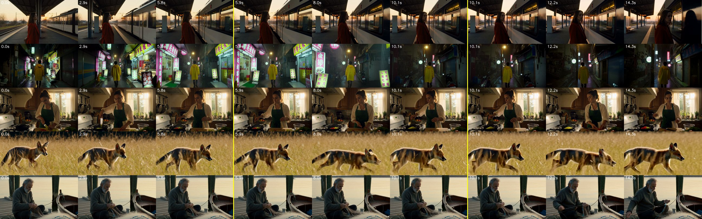

Arm c, Geiru full:
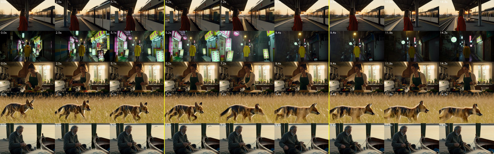

Read (arms a and c looked at): a: scene 1 darkens and the woman falls into shadow by 14 s, scene 2 and 4 darken/saturate, fox striping; c: scene 1 stays bright but the train leaves (look held, story reset), scenes 3 and 5 equal to a.

## What it means for the extend tool
1. Chain (h3_extend) is a good default: seamless joins, 1-2 min per 14 s on a 5090 at 0.4 MP, no identity break. Standard = chain + Seam Normalize, Anti-Burn greyed-on only for long targets.
2. Strong = Geiru bundle; label "keeps the look, may reset the action". Needs the Geiru nodes; wire the previous shot straight from the sampler output (no Save/Load Latent).
3. Follow-ups: U46b latent-carry chain vs VAE re-encode (explains arm d's saturation result); a 6-10 segment run to see where Anti-Burn starts to pay (budget ~12 min per 10 segments at ~40 s); keystone vs capstone placements on moving shots.

## Caveats
Single seed per cell, 5 scenes, 14 s only (the literature's burn appears by 30 s), 0.4 MP, no de-rope, Pika Flex turbo only (Anti-Burn's best strength is turbo-specific), no listening test, no ArcFace. Arms a/b vs c/d differ in engine as well as protection (d is the bridge).

---

# U46b - latent carry vs VAE re-encode, and Anti-Burn on long chains (2026-11-04 18:42-19:07)

## Verdict
- **The chain's saturation creep is caused by the per-segment decode + VAE re-encode of the tail.** Carrying the tail latent straight from the sampler output (arm f)
  cuts saturation creep on the two worst U46 scenes from 1.42 / 1.30 to 1.10 / 1.02 (3 segments) and, at 8 segments, scene 1 peaks at 1.16 (chain a: 1.58) and ends 1.08
  (a: 1.37). Lab drift first vs last second 37 / 16 -> 23 / 15 (3 seg), 29.6 -> 8.0 (scene 1, 8 seg). **The Standard chain should carry latents** (the Geiru context node path,
  protection off), not the h3_extend decode/re-encode path. Seams are no worse (spike 0.3-2.2x median, a: up to 3.3x). Caveat: f is the Geiru engine (head 39, drop_last 17, hold_audio),
  so it differs from a in more than the carry; it is the same engine as U46 arm d minus Anti-Burn, and d's 0.98 saturation was therefore the carry, not the LoRA.
- **Anti-Burn does not pay anywhere up to 8 segments (35.6 s, 832x480) on latent carry.** With carry there is almost no burn left to cancel: saturation f 1.08 vs g (+AB 0.5) 1.01 on the moving scene, 0.93 vs 0.91 on the
  locked scene (both within the noise of single seeds), and Anti-Burn's softness is real: Laplacian detail last/first segment 0.59 vs 1.41 (scene 1) and 1.02 vs 1.32 (scene 3); on the moving scene detail
  sinks monotonically to 0.46 by segment 6 with Anti-Burn. No crossover in 8 segments. **Standard default: Anti-Burn OFF at every length tested (up to ~35 s);** keep it as an opt-in slider
  (and for the old chain only, where creep is real, see below). The threshold of the card (~6+ segments, ~37 s) was measured on the VAE-re-encode path, which is where the burn comes from.
- Note f's detail *rises* (1.3-2.1x by the last segments, scene 1 segs 6-7 where the camera is on empty rails): latent carry may accumulate a sharpening/noise texture. Not examined (no detail artifact visible on the sheets; 35 s only).

## Arms
Seeds 46000+100*scene+k, same prompts as U46; metrics per segment.
- a: plain chain (U46 arm a; 3-segment clips reused from U46, 8-segment scene 1 re-run with the same graph).
- f: Geiru latent carry (Geiru Context: head 39, drop_last 17, hold_audio, protection off, previous shot = sampler output wired directly) with no LoRA; segments joined per the Geiru README (124 / 102 each / 119 frames).
- g: f + Anti-Burn universal v1 0.5 on segments 2+ (= U46 arm d).
- Exp 1: a vs f, scenes 1 (woman, tracking) and 2 (alley, handheld), 3 segments (345 frames). Exp 2: 8 segments (855 frames = 35.6 s), scene 1 (moving) and scene 3 (locked off): f and g, plus a on scene 1 (5 renders; 2 + 5 = 7 clips plus U46's two reused).
  Wall-clock: ~100 s per 3-segment clip, 210-240 s per 8-segment clip from cold (about 28 s per extra segment, below the chain's ~40 s).

## Numbers
Exp 1 (3 segments):
| | a chain scene 1 | f carry scene 1 | a scene 2 | f scene 2 |
|---|---|---|---|---|
| Saturation last/first segment | 1.42 | **1.10** | 1.30 | **1.02** |
| Lab drift first vs last second | 37.4 | 23.1 | 16.3 | 14.5 |
| Detail last/first | 0.76 | 0.79 | 0.22 | 0.23 |

Exp 2 (8 segments; per-segment values, segment 1 = 1.00 for ratios):
| clip | saturation ratio by segment | detail ratio by segment | seam spike (7 joins, x median) |
|---|---|---|---|
| a, scene 1 | 1.00 1.20 1.42 1.58 1.35 1.21 1.18 1.37 | 1.00 .93 .76 .56 .79 .80 .90 .84 | 1.2 0.8 3.3 1.2 1.2 1.4 2.4 |
| f, scene 1 | 1.00 1.07 1.10 1.12 1.16 1.15 1.09 1.08 | 1.00 .86 .78 .95 1.15 1.61 2.11 1.41 | 0.8 0.3 1.6 2.2 1.0 1.5 0.7 |
| g (f+AB), scene 1 | 1.00 1.07 1.07 1.04 1.08 1.09 1.08 1.01 | 1.00 .81 .68 .59 .51 .46 .96 .59 | 1.0 0.3 1.6 2.0 0.7 2.0 0.8 |
| f, scene 3 | 1.00 .96 .98 .97 .95 .94 .94 .93 | 1.00 .99 1.05 1.10 1.11 1.24 1.26 1.32 | 1.3 1.8 1.0 1.0 1.3 1.0 1.4 |
| g (f+AB), scene 3 | 1.00 .96 .97 .95 .94 .93 .92 .91 | 1.00 .95 .99 .99 .97 1.00 .98 1.02 | 1.4 1.6 1.2 1.0 1.4 1.3 1.3 |
Lab drift vs first second, last segment: a 22.5, f 8.3, g 13.8 (scene 1); f 11.4, g 13.3 (scene 3). Scene 1 drift mid-clip (25-36) is the shot itself changing (train passes, sun sets), same in all arms.

## Plots and sheets

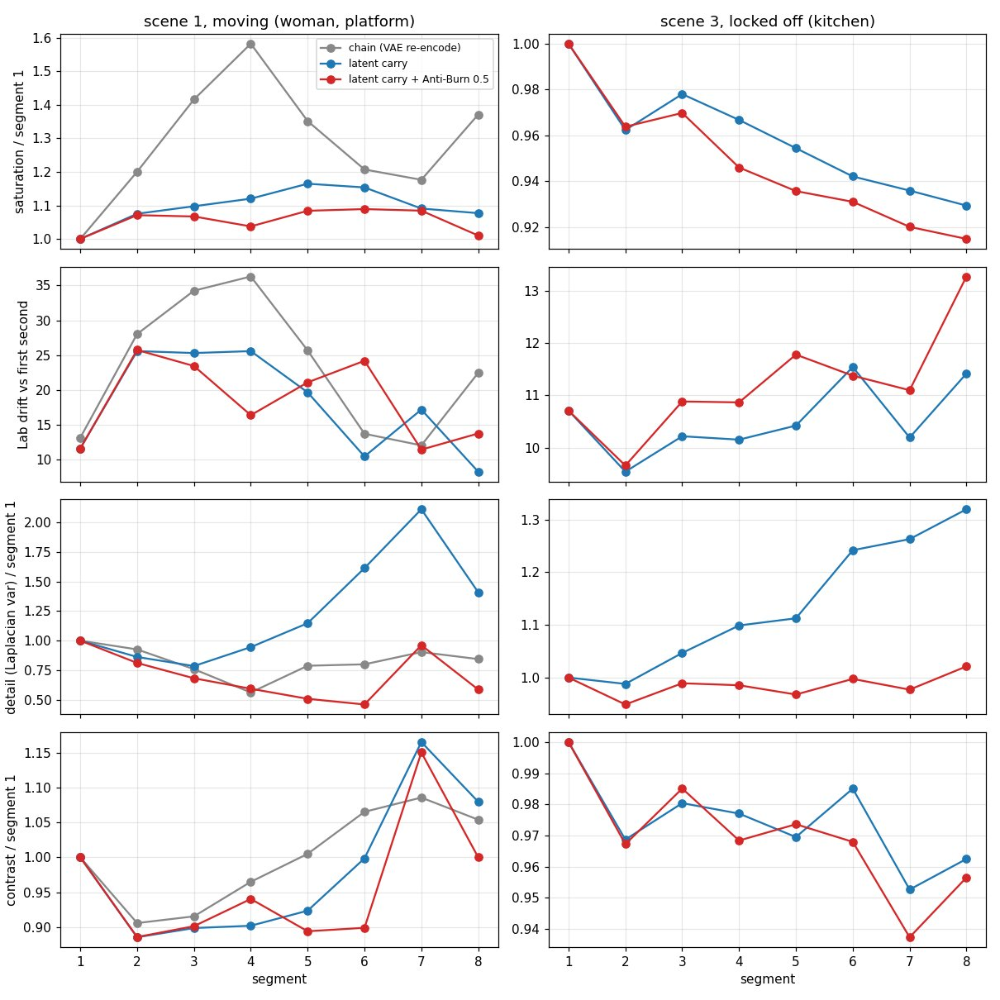

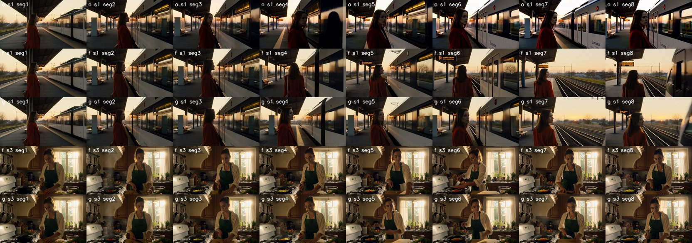

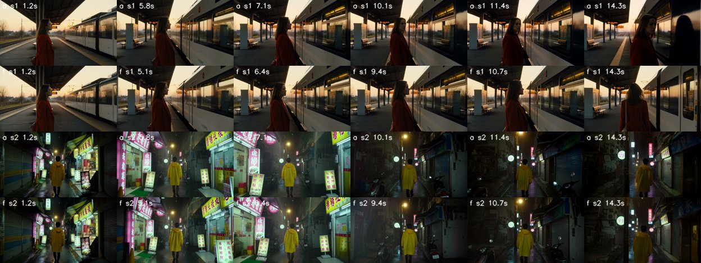

Read by eye: a scene 1 goes dark in segment 4 (the woman nearly silhouetted) then recovers; f keeps the exposure and lets the story evolve (train leaves, camera turns to the rails) with the same woman; g scene 1 looks like f, softer; the locked kitchen is the same in f and g through 35 s (same person, same light), so burn never appears there in either arm. Alley (exp 1): a and f both go dark/blue after ~9 s (scene change, not creep); f slightly less saturated.

## What it means for the extend tool
1. Standard chain = latent carry (Geiru context, protection off, join per Geiru README), Anti-Burn off; faster per segment than the h3_extend path. h3_extend's masked VAE re-encode is the saturation source and should not be the default; keep it only if a 'masked carry' feature is needed.
2. Anti-Burn slider stays opt-in; no length at which it wins was found up to 35 s. Re-test only if a longer chain (60 s+) or the old re-encode path is offered.
3. Strong (Geiru bundle) is unchanged; its distinct property is anti-drift of the story, not of the colour.
Caveats: single seed, 2 scenes, 35 s max, 0.4 MP, Anti-Burn only tested on the carry path (not on an 8-segment re-encode chain, the one place it might still help); f vs a also differs in engine (see verdict); no listening test; detail rise in f unexamined.


---

# U46c - shipping the latent carry (2026-11-04, 19:55-20:27)

- **A take's file can seed a latent carry without re-rendering it:** encode only its last 39 frames and their sound (ImageFromBatch + TrimAudioDuration, VAEEncode + VAEEncodeAudio, core's LTXVConcatAVLatent, which takes any AV model) and give that to Geiru Context as `previous_shot`. A take of 17k+5 frames ends on a block boundary, so the 39-frame tail lines up. One encode per extension, none per clip.
- **Geiru joins in one graph:** the take keeps [0, F-17); clip k keeps [22, L-17) (the last one [22, L)); Seam Normalize fits on the 22 held frames: the take's [F-39, F-17) for clip 1, the previous clip's normalized [L-61, L-39) after. Audio is cut with TrimAudioDuration in seconds (frames / 24) and joined with AudioConcat.
- **Crop check first:** the carry's rising detail (U46b) read at 100% as slightly crisper faces and knit by clip 8, no grain, so Standard ships on the carry.
- **GPU check at 1280x704:** Standard 2 clips = 311 frames in 190 s with the model load (joins continuous, colour holds, sound -29.7 dB); Strong 1 clip 90 s (join continuous; the end walks back toward the take's end). 1280x704 costs about twice 832x480.

---

# U46d - 2-minute loop drift test (2026-11-04 21:04-22:40)

Dylan's design (2026-11-04 21:04): a 3-prompt cycle that returns to its start, repeated, so segment k and k+3 are the same content and drift is measured on like for like ("walking around a fountain over and over").

## Verdict
- **Standard holds the look for about 3 loops (~40 s) and then visibly decays; by 2 minutes it is not usable on a static, repeated shot.** Scene 1 stone walls and cobbles sprout a swirling mosaic texture from loop 4 (~50 s, first visible), plainly from loop 5-6, and by loop 8 (~100 s) the face is a smeared blob, the coat has changed hue, and the action has stopped matching the prompt (she turns away). Full-res detail (Laplacian var) vs loop 1: 1.06 / 1.10 / 1.17 / 1.25 / 1.35 / 1.49 / 1.63 over loops 2-8. Lab drift 5.2, saturation 1.07, contrast 0.96 and DINOv3 same-phase 0.90 at loop 8 are small, so **global colour numbers hide it: U46b's "rising detail" is the failure signal and it does not plateau.** U46c's crop check at 100% (8 clips, 35 s) was right for that length; the loop test shows the same mechanism running away past ~45 s.
- **Strong (Geiru bundle) holds for the whole 2 minutes on the locked-off person scene**: detail 1.07, Lab drift 1.9 (max over phases 3.5), saturation 0.99, DINOv3 0.975 at loop 8, stone and basin identical to loop 1 at 100%; the coat stays the same mustard (coat drift 5-9 vs Standard 24), the person still reads as the same woman with scarf and beret. Cost as before: it re-anchors to clip 1, so the walk is not the prompt's (loop 8 phase A shows her from behind) and pigeons accumulate. For long clips Strong is the right method; "keeps the look" now means "is the only one that survives 2 minutes".
- **Re-encode chain (control) fails fast**: detail 1.48x at loop 2, 5.8x by loop 5, 9.2x at loop 8 (wall = confetti, basin unreadable), saturation 1.27, contrast 1.21, DINOv3 0.83, audio rises from -46 to -14 dB (noise). Visible by loop 2-3 (~25 s).
- **Anti-Burn stays off for Standard.** Not retested here; U46b still says it only softens. The fix for long Standard is not a LoRA but a re-anchor: the open question below.
- **Scene 2 (person-free camera orbit) did not give a usable loop**: the orbit never returns to the same views, so same-phase comparison measures the camera, not drift (DINOv3 0.5-0.6 in every arm from loop 2, Strong's Lab 15 vs Standard 10). Read it by eye (sheets 272, 273, 275): Strong keeps the plaza's palette and fountain; Standard keeps the shape but loses detail (0.32x full-res) and gets contrastier; the re-encode chain darkens with contrast 1.75x and burns the sky to white by loop 7-8. Identity vs scene separation therefore comes from scene 1: the texture failure is scene-wide (walls/cobbles), so it is not an identity problem, and the person degrades with the scene.
- **Recommendation:** Standard up to ~40 s (2-3 extensions of ~13 s from a take), then offer Strong ("keeps the look") or warn; in a long-clip UI the method should switch to Strong for targets past ~45 s. Re-test an in-between: Standard that re-anchors (keystone only, or Standard + Late Lock without the LoRA/noise) every ~3 clips; not done.

## Design
- Segment L = 141 frames at 832x480, 24 segments = 8 loops x 3 phases, one seed per run (47000 + 100 x scene + segment); joined frames 124 + 22 x 102 + 119 = 2487 = 103.6 s (a hair under 2 min; 24 not 25 segments so loops are whole). Each phase has one fixed prompt, same every loop; segments 2+ use the "shot continues without a cut" wording of U46.
- Scene 1 (locked-off wide shot, same fixed camera): town-square round stone fountain, bakery awning left, a young woman in a mustard-yellow trench coat, crimson scarf, black beret, long dark hair. A: walks from the left foreground toward the fountain facing camera. B: passes behind the fountain through the spray, left to right. C: comes back round the right side and curves to the left foreground where she began. Soundscapes name discrete events (shoes on cobbles, water splashing, a pigeon's wings, coat rustling; church bell in B).
- Scene 2: same square, nobody in it, camera glides slowly round the fountain at eye height; A south (bakery awning, town hall), B east (cafe, arcade), C north (church, bell tower), "moving slowly right and back toward the south". Sound: splashing water, pigeons, cup clink, bell.
- Arms (one API prompt per run, every kept segment its own SaveVideo, joined for measuring only):
  - S Standard = U46c's shipped graph: Geiru Context (protection off, head 39, drop_last 17, hold_audio) carrying the previous sampler latent, Seam Normalize (linear-light channels, gain 1.25) fitted on the 22 held frames, Anti-Burn off. Segment 1 is sampled from text (no take to encode the tail from), so it differs from the shipped path only there.
  - G Strong = Geiru bundle: + protection LoRA (Anti-Burn 0.5, never shot 1), context noise 1.0 linear, keystone front + capstone back from clip 1, Late Lock at step 3 (U46 arm c), + the same Seam Normalize.
  - R = h3_extend masked VAE re-encode chain with Seam Normalize (U46 arm a), 141 + 102 per segment.
- Same prompts/seeds across arms; segment 1 is identical across arms.
- Metrics: per segment, against loop 1's same phase: Lab distance of segment mean, saturation / contrast ratios at 416x240; Laplacian variance at full 832x480 on the middle frame (the 416x240 version under-reads the failure: 1.22x vs 1.64x for Standard loop 8); DINOv3 (a DINOv3 copy score) of the middle frame vs loop 1's; audio dB per segment. Identity (scene 1): coat colour (Lab of the mustard pixels) and ArcFace IR101 on SAM 3.1 face + hair masks.

## Per-loop numbers (mean of phases A/B/C vs loop 1 same phase; scene 1)
| loop (time) | S Lab / sat / detail / DINOv3 | G Lab / sat / detail / DINOv3 | R Lab / sat / detail / DINOv3 | coat drift S / G / R | audio dB S / G / R |
|---|---|---|---|---|---|
| 2 (13 s) | 0.8 / 1.00 / 1.06 / .969 | 0.9 / 1.00 / 1.01 / .976 | 1.6 / 1.05 / 1.48 / .970 | 3.6 / 5.0 / 4.0 | -39 / -44 / -41 |
| 3 (26 s) | 1.1 / 1.01 / 1.10 / .960 | 1.1 / 1.00 / 1.03 / .979 | 2.4 / 1.07 / 2.49 / .958 | 7.6 / 8.3 / 18.4 | -33 / -40 / -31 |
| 4 (39 s) | 2.1 / 1.03 / 1.17 / .957 | 1.4 / 1.00 / 1.03 / .975 | 3.6 / 1.08 / 4.04 / .931 | 10.6 / 6.9 / 24.1 | -32 / -39 / -18 |
| 5 (52 s) | 2.8 / 1.04 / 1.25 / .932 | 1.1 / 1.00 / 1.05 / .961 | 4.4 / 1.08 / 5.76 / .911 | 12.8 / 6.5 / 29.5 | -30 / -40 / -14 |
| 6 (65 s) | 3.5 / 1.05 / 1.35 / .923 | 0.8 / 1.00 / 1.05 / .970 | 5.5 / 1.12 / 7.10 / .896 | 21.9 / 5.0 / 35.6 | -38 / -33 / -14 |
| 7 (78 s) | 4.2 / 1.06 / 1.49 / .915 | 1.2 / 0.99 / 1.07 / .971 | 7.6 / 1.18 / 8.21 / .855 | 23.7 / 5.7 / 40.0 | -43 / -45 / -14 |
| 8 (91 s) | 5.2 / 1.07 / 1.63 / .904 | 1.9 / 0.99 / 1.07 / .975 | 9.2 / 1.27 / 9.16 / .825 | 23.7 / 9.5 / 39.0 | -34 / -48 / -14 |
Contrast ratio at loop 8: S 0.96, G 0.98, R 1.21. Loop 1 audio: -44 / -46 / -47 dB.
- **ArcFace identity is not usable here**: the person is ~20-30 px wide in the wide shot; SAM found a "face" in 22/24 (S), 17/24 (G), 13/24 (R) frames, but crops that small give cosine 0.2-0.6 against loop 1 even in G where the woman is visibly the same (S mean 0.35-0.59, G 0.30-0.51, noisy, below the 0.35 "different person" line in loops 5-6 for S). Not a verdict. By eye at 100% (278): G loop 8 is the same woman (back view, same coat/scarf/beret); S loop 8 face is a smeared pink blob; R loop 8 is not a person. Hair lightness not scored (hair mask too small).
- Hair/outfit notes: coat hue drift (above) is the usable identity number: S 24 / G 9.5 / R 39 Lab units at loop 8 (G's 5-9 is mostly changing light and pose).
Scene 2 (no person), loop 8: S Lab 9.8 / sat 1.20 / detail 0.32 / DINOv3 .51; G 14.9 / 1.12 / 0.64 / .52; R 8.8 / 1.07 / 0.61 / .43 with contrast 1.75 (not a repeat, see verdict).
- Wall-clock for 24 segments (one prompt each, cold load included): S 740 s / 750 s (31 s per segment), G 810 s / 851 s (34-35 s), R 1004 s / 991 s (42 s). Total GPU 87 min for 6 runs.

## Plots and sheets (rows = phases A/B/C, columns = loops 1-8, middle frame of each segment)

Standard:
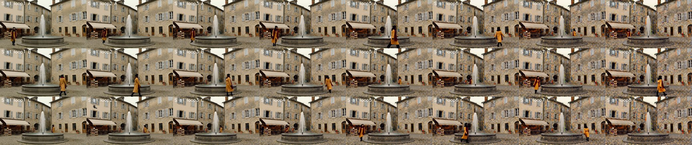

Strong:
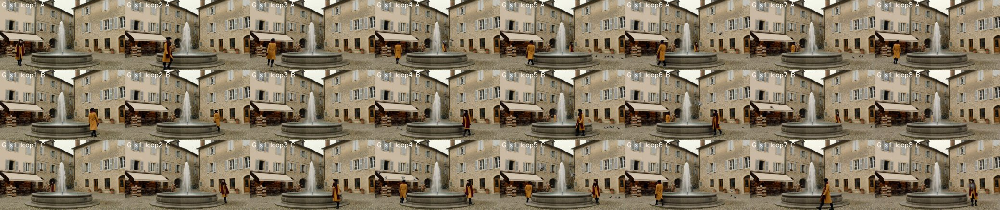

Re-encode chain:
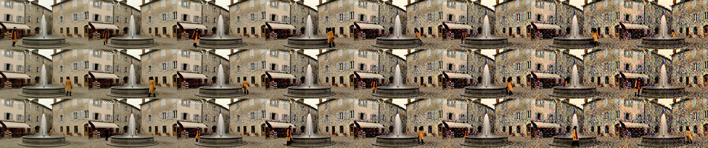

Metrics per loop (lines = S / G / R):
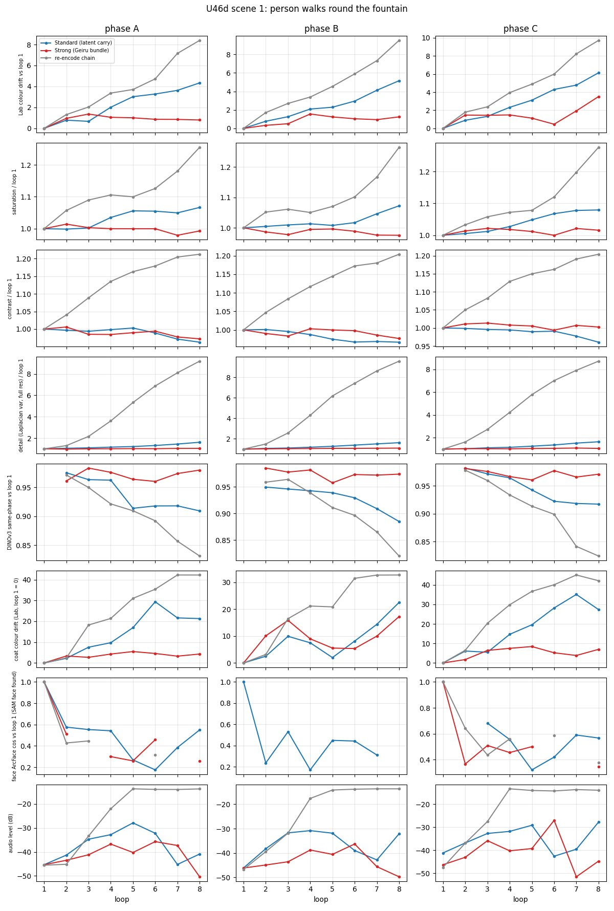

Crops at 100%, head and basin, loop 1 vs loop 8 (rows S / G / R):
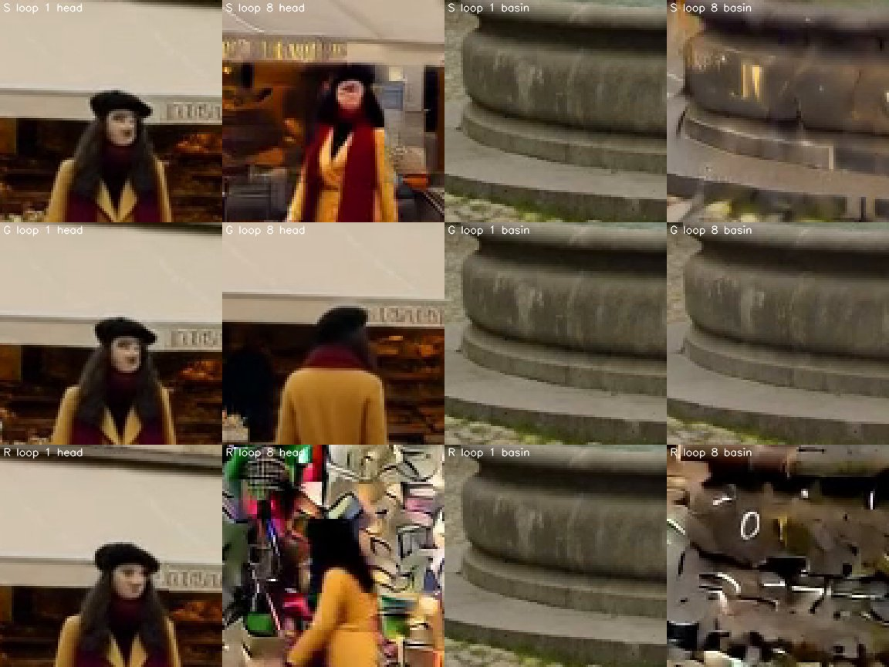

## Caveats
One seed per cell, 832x480, int8 Pika-Flex turbo; one static-camera scene (a locked wide shot is the worst case for texture accumulation: nothing moves to hide it, a moving camera or tight shot may last longer, U46's moving scenes drifted in colour first); segment 1 sampled from text; scene 2 is not a repeating loop (the orbit prompts do not close), so no clean person-free control; ArcFace too small to score; audio not listened to (R's -14 dB rise is noise by the level; S and G vary with the events); Seam Normalize and Standard vs Strong differ in more than one component so "which part of Strong" is open (keystone vs capstone vs late lock vs noise).
Open follow-ups: (1) Standard + a single re-anchor (keystone or Late Lock only) at every 3rd clip; (2) a tight-framed person for ArcFace (head ~150 px); (3) a scene-2 loop that closes (fixed camera, rotating fountain light, or a turntable); (4) does the Standard texture rise start from the carry's detail rise noted in U46b (1.3-2.1x) or from accumulated latent noise.


---

# U46e - a re-anchor middle for long clips (2026-11-04 22:39-23:17)

Question from U46d: does Standard plus a periodic re-anchor hold 2 minutes with less of Strong's action reset? Same scene 1, seeds, prompts and graph as U46d (S and G numbers reused from U46d, not re-rendered). Every 3rd/6th segment (k % period == 0, always phase C) is re-anchored; all other segments are the plain Standard graph.

## Verdict
- **Yes: Standard + a keystone/capstone re-anchor every 3 clips holds the full 2 minutes, as well as Strong does, with no LoRA and no context noise.** K3 at loop 8: Lab 1.1, saturation 1.00, contrast 0.99, full-res detail 1.07, DINOv3 0.968 (G: 1.9 / 0.99 / 0.98 / 1.07 / 0.975; S: 5.2 / 1.07 / 0.96 / 1.63 / 0.904). At 100% ([sheet 291](../figures/extend/291_u46e_crops_loop1_vs_8.jpg)) the fountain basin at loop 8 is identical to loop 1 and the wall behind the woman is clean stone (S: smeared; L3: mosaic).
- **Every 6 clips is enough on this scene.** K6 at loop 8: Lab 2.0, sat 1.02, detail 1.10, DINOv3 0.957; detail never above 1.10 at any loop (S 1.63); wall and cobbles clean at 100% in the loop 8 frame. It is slightly looser than K3 (Lab 2.0 vs 1.1, detail 1.10 vs 1.07) but cheaper: only 3 of 24 segments pay the anchor.
- **Late Lock is the wrong half.** L3 (keystone + capstone graft + Late Lock at step 3, same cadence) decays almost like Standard: detail 1.42 / Lab 3.4 / DINOv3 0.935 at loop 8, the mosaic texture is on the walls and cobbles at loop 8 ([sheet 291](../figures/extend/291_u46e_crops_loop1_vs_8.jpg) row L3), only a little later than S (detail ceases to climb at loop 7-8 where S keeps going). Do not offer Late Lock in the middle. (The keystone/capstone graft alone does the work; with Late Lock the keystone front slot is held empty to step 3 and the plain carried latent drives the first steps, which is where the texture comes in.) Not investigated further.
- **Action reset: the re-anchor moves the action once, then it is steady; it is the same kind of reset as Strong's, not a smaller one.** K3 phase A is at loop 1 the prompt's walk from the left foreground facing the camera (identical in all arms, nothing to anchor yet); from loop 2 on (first anchor at segment 3) phase A shows her at the right of the fountain walking away/in profile, at nearly the same spot every loop (mustard-coat centroid x 289-297 of 416, y 169-174, six loops running); K6 does the same one anchor later (loop 1-2 as Standard, then x 230-306 from loop 3 after the segment-6 anchor). G also turns her away, from behind, and wanders more (x 154-257, pigeons accumulate); S keeps facing her toward the camera for loops 1-4 and then melts. At the joins nothing jumps: coat centroid jump across the last frame of one segment to the first of the next is 0.7-16 px of 416 in every arm (anchored joins K3 up to 14 px; S has a 15 px one too), no cut back to clip 1's composition. So with a re-anchor the person ends up in one steady pose and place that is not the prompt's, as with Strong, but without Strong's drifting position and with no accumulating pigeons (read by eye on [sheet 290](../figures/extend/290_u46e_K3_s1_loops.jpg), 294, 271).
- **Recommendation, "Long" between Standard and Strong: Standard carry + Geiru keystone front + capstone back from clip 1 every 6th clip (K6), tighten to every 3rd (K3) when the scene is static or the user sees texture; no Late Lock, no protection LoRA, no context noise.** Standard stays right up to ~40 s (3 clips); from clip 4 on the re-anchor is on. It needs Geiru Context's degradation_protection flag on for the anchored segments (Keystone passes through otherwise) but not the LoRA. Strong stays for users who want the LoRA/noise/Late-Lock bundle; U46e finds nothing in that bundle beyond the re-anchor that the 2-minute loop needs.
- Cost: wall-clock K3 740 s, K6 740 s, L3 670 s for 24 segments (31 s/segment, = Standard's 740-750 s; Strong was 810-850 s). The re-anchor costs nothing measurable.

## Per-loop numbers (mean of phases A/B/C vs loop 1 same phase; scene 1; S, G from U46d)
| loop | S Lab / sat / det / DINO | G | K3 | K6 | L3 |
|---|---|---|---|---|---|
| 2 | 0.8 / 1.00 / 1.06 / .969 | 0.9 / 1.00 / 1.01 / .976 | 0.6 / 1.00 / 1.04 / .965 | 0.8 / 1.01 / 1.05 / .970 | 0.7 / 1.01 / 1.05 / .981 |
| 3 | 1.1 / 1.01 / 1.10 / .960 | 1.1 / 1.00 / 1.03 / .979 | 0.7 / 1.00 / 1.05 / .967 | 0.8 / 1.00 / 1.08 / .968 | 1.1 / 1.02 / 1.11 / .975 |
| 4 | 2.1 / 1.03 / 1.17 / .957 | 1.4 / 1.00 / 1.03 / .975 | 0.7 / 0.99 / 1.06 / .966 | 1.2 / 1.01 / 1.10 / .965 | 1.9 / 1.03 / 1.16 / .960 |
| 5 | 2.8 / 1.04 / 1.25 / .932 | 1.1 / 1.00 / 1.05 / .961 | 0.6 / 1.00 / 1.07 / .966 | 1.2 / 1.01 / 1.07 / .967 | 2.6 / 1.04 / 1.23 / .948 |
| 6 | 3.5 / 1.05 / 1.35 / .923 | 0.8 / 1.00 / 1.05 / .970 | 0.8 / 1.00 / 1.09 / .967 | 1.4 / 1.01 / 1.09 / .962 | 3.2 / 1.05 / 1.35 / .937 |
| 7 | 4.2 / 1.06 / 1.49 / .915 | 1.2 / 0.99 / 1.07 / .971 | 0.7 / 1.00 / 1.07 / .961 | 1.1 / 1.01 / 1.09 / .966 | 3.7 / 1.06 / 1.48 / .930 |
| 8 | 5.2 / 1.07 / 1.63 / .904 | 1.9 / 0.99 / 1.07 / .975 | 1.1 / 1.00 / 1.07 / .968 | 2.0 / 1.02 / 1.10 / .957 | 3.4 / 1.05 / 1.42 / .935 |
Loop 1 is the reference for each arm; in the re-anchor arms the loop-1 phase C segment (k=3) is already anchored, a small difference from the S/G reference.
Audio (mean dB over the loop's segments, not listened to): K3 -42 to -27, K6 -39 to -20 (loops 4-6 around -20), L3 -41 to -14 (L3 loops 4-8 -14 to -24, the re-encode chain's noise level), S -44 to -30, G -46 to -39. K6's -20 dB at loops 5-6 and K3's -27 at loop 4 are louder than Standard's; whether that is events (pigeons, bell) or noise is open: listen before shipping.
Coat-centroid px count (mustard mask) rises 3x for S (1000 -> 3000: the mosaic matches the mask) and L3 (1000 -> 3600), stays flat for G and K3/K6 (800-2100): a second texture-growth signal.

## Plots and sheets

K3 loops (rows = phases A/B/C, columns = loops 1-8):
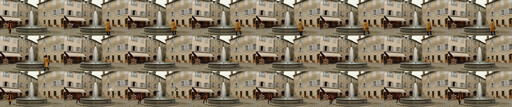

Crops at 100%, head and basin, loop 1 vs 8 (rows S / G / K3 / L3 / K6):
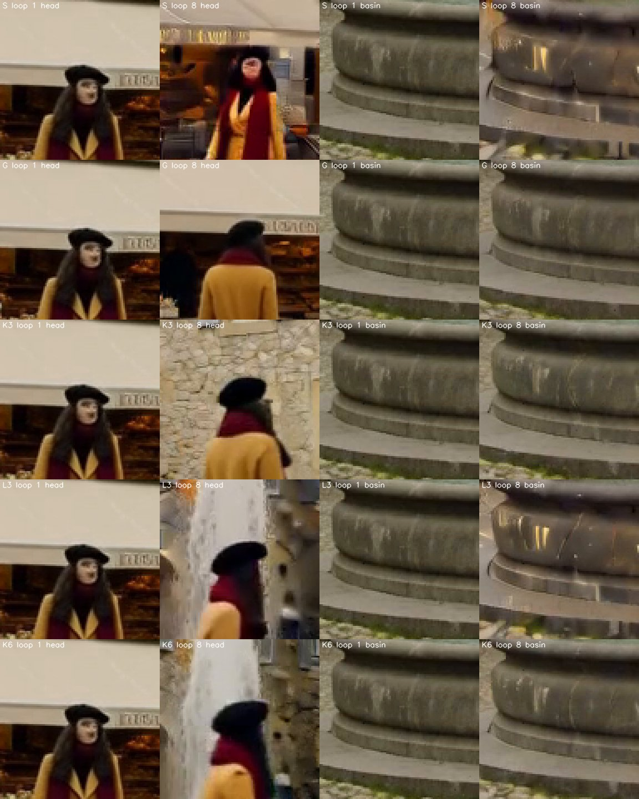

Metrics per loop:
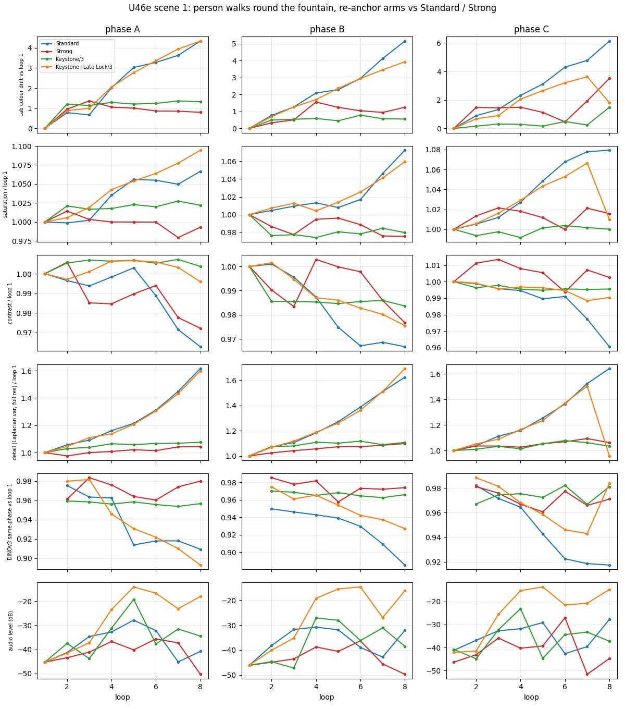

## Caveats
One seed, one static scene, 832x480, 24 segments (103.6 s); anchors always fall on phase C (period 3 and 6 divide the 3-phase cycle), so the anchor phase is confounded with the content; no period other than 3 and 6 tested (a period 2 or 4 may do as well; 9+ untested); "KL3 both" is not a distinct arm because Late Lock needs a Keystone graft (L3 is keystone + Late Lock), so there is no keystone-less Late Lock to test; the coat metric is a crude mustard mask; ArcFace still too small; audio not listened to. The re-anchor does not bring back the prompt's phase-A action (she turns away) in any arm after the first anchor, so a user who needs the walk to follow the prompt over 2 minutes is not served by K3/K6 or G.


---

# U46f - identity loop test, front-facing close-up (2026-11-04 23:20 to 2026-11-05 00:25)

Dylan: "why is the lady so small... full screen walking and tracking them as they loop around... looking at them from the front. The potato face doesn't help us tell." Same 3-phase fountain loop, same woman and outfit, same graph and seeds as U46d/U46e (the U46d graph plus U46e's re-anchor, prompt = new scene 3; seed 47300 + k; 24 segments = 103.6 s, 832x480). Arms: S Standard, K6 Long (re-anchor every 6th clip), K3 Long (every 3rd), G Strong. Segment 1 is identical in all four arms.

## Framing check (face px) and the prompt that passed
- v1 "medium close-up ... face and shoulders filling the frame": she opens small at the fountain; face ~120 px at the end of clip 1. Rejected. v2 "close-up from the very first frame": still a small figure on frame 0, ~130 px. The coordinator saw the same and asked for the shot to OPEN as a medium close-up.
- v3 (final): "the shot opens and stays a front-facing tracking medium close-up: the camera is already right in front of her, walking backward ahead of her, her face and shoulders filling most of the frame from the very first frame, she looks into the camera", fountain and plaza "soft/blurred behind her", and the same "camera right in front of her walking backward, her face and shoulders filling most of the frame, facing the camera" sentence in every phase. Frame 0 of clip 1 is still wider (she stands right of centre, face ~100 px) but she is large from about frame 40.
- Measured (SAM 3.1 face mask box height on the middle frame of every segment; the 150 px line is a face-mask height): clip 1 = 122 px (middle of the opening clip, still settling); from clip 2 on S 148-197 (mean 182 from loop 3), K6 148-181 (mean ~160), K3 137-167 (mean ~150), G 145-186 (mean ~167). So the face is ~150 px or more in all arms except the very first clip and about a third of K3's clips (137-148). A face is found in 24/24 clips in every arm. By eye she fills the frame in every arm and every loop (sheets 300-303).
- Side effect of this framing: the fountain is mostly out of frame (a basin edge or a spray in the corner in some loops), and the background is whatever plaza is behind her; the camera moves, so DINOv3 same-phase and Lab drift compare different backgrounds (see caveats).

## Verdict
- **K3 keeps her the same person for the whole 2 minutes; K6 does almost as well; G keeps the face but turns the hair and the world into something else; S loses her by loop 5-6.** At 100% ([sheet 304](../figures/extend/304_u46f_faces_phaseA.jpg)-306) Standard is a recognisable woman through loop 4, picks up a mosaic on skin at loop 5, and is a smeared mask by loops 6-8 (ArcFace to loop 1 0.33 / 0.36 / 0.31, the "different person" line is 0.35; the full-res detail ratio 4.35 / 6.74 / 8.72). K6 and K3 faces at loop 8 are the loop-1 woman, same hair length and parting, same eyes and brows, no texture. Strong's face is clean but its hair goes darker by 19 L* units between loop 1 and loop 8 (steady, [sheet 304](../figures/extend/304_u46f_faces_phaseA.jpg) bottom row: the beret and hair merge into one black mass) and its skin and the background change over the loops (see below).
- ArcFace baselines first: even a good clip scores only ~0.75-0.9 against loop 1 because pose, light and expression differ (K3 0.89 / 0.85 / 0.82 / 0.76 / 0.83 / 0.75 / 0.78 over loops 2-8; K6 0.86 / 0.83 / 0.77 / 0.83 / 0.75 / 0.83 / 0.79; G 0.85 / 0.83 / 0.77 / 0.76 / 0.76 / 0.74 / 0.74; S 0.85 / 0.83 / 0.74 / 0.56 / 0.33 / 0.36 / 0.31). Cosines of 0.75-0.85 are "same woman" here, below 0.4 is the failure.
- **Does Long's re-anchor cost identity? No.** K3 and K6 are as close to loop 1 as Strong in ArcFace (0.75-0.85) and keep the hair (hair L* p90 within -2 to +4 of loop 1 in K3/K6 for every loop vs G -5 at loop 2 falling to -19 at loop 8, S -1 to -5). **Does it cost the front-facing framing? No.** In every arm, in every loop and phase, she is front-facing, centred, face 140-195 px, looking at the camera; nobody turned away after an anchor (U46e's turn-away happened on a locked wide shot; with the camera leading her there is nothing to turn from). The anchors do not move her within the frame or change her scale visibly (K6 face height range 148-181 vs S 148-197). That the face is a little bigger in S/G than K3 (150 vs 183) is the carry's slow zoom-in, not the anchor.
- **K3 vs K6:** K3 is cleaner (identity cos stays 0.75-0.89, detail 1.1-1.5 of loop 1, background plaza the same around loop 8 as loop 2, [sheet 302](../figures/extend/302_u46f_K3_s3_loops.jpg)); K6 has a loop-4 face at 181 px (a jump in zoom) and a small Lab swing (8-9 at loops 6 and 8); full-res detail is the same for both (1.1-1.5 of loop 1). Both read as the same woman at 100%. K3 is the safer default for a face-led shot; K6 is acceptable.
- **G (Strong) loses on this shot:** with the keystone+capstone from clip 1 plus protection LoRA and context noise the camera "reset" is no longer a plaza: from loop 3 the street behind her turns into a wide-angle, converging row of houses (loops 5-8), the hair darkens 19 L*, saturation falls to 0.88-0.95 and detail climbs to 2.4x loop 1 by loops 6-8 (colder, harder texture on the street) while the face is clean. Not the same world; K3/K6 are better on both identity and scene.
- **Recommendation for the long-clip default on face-led shots: Long K3** (K6 as the cheaper option); Standard past ~40-50 s is not safe for a face (loop 4, 52 s, is the last good one: cos 0.74, detail 1.85 and rising; loop 5 mosaic skin). This confirms U46e on a far harder identity test: the re-anchor does the work, nothing else in Strong is needed, and Strong's bundle hurts hair and scene on a close-up.

## Per-loop table (mean of phases A/B/C vs loop 1 same phase; scene 3; face crops at 100% in [sheet 304](../figures/extend/304_u46f_faces_phaseA.jpg)-306)
| loop (time) | S arc / hair dL / detail | K6 arc / hair dL / detail | K3 arc / hair dL / detail | G arc / hair dL / detail |
|---|---|---|---|---|
| 2 (13 s) | .85 / -0.4 / 0.84 | .86 / -0.3 / 0.79 | .89 / +3.0 / 1.19 | .85 / -5.2 / 0.70 |
| 3 (26 s) | .83 / -2.5 / 1.01 | .83 / -1.1 / 0.92 | .85 / +4.0 / 1.30 | .83 / -10.3 / 0.70 |
| 4 (39 s) | .74 / -2.3 / 1.85 | .77 / -1.9 / 0.96 | .82 / -4.1 / 1.43 | .77 / -14.1 / 0.88 |
| 5 (52 s) | .56 / -5.4 / 2.47 | .83 / -1.2 / 1.32 | .76 / -1.6 / 1.50 | .76 / -16.0 / 1.20 |
| 6 (65 s) | .33 / -4.2 / 4.35 | .75 / -0.9 / 1.30 | .83 / -0.2 / 1.28 | .76 / -16.4 / 2.09 |
| 7 (78 s) | .36 / -1.3 / 6.74 | .83 / -0.5 / 1.43 | .75 / -0.1 / 1.11 | .74 / -17.8 / 2.41 |
| 8 (91 s) | .31 / -1.3 / 8.72 | .79 / -0.3 / 1.25 | .78 / +0.5 / 1.09 | .74 / -19.1 / 2.42 |
"arc" = ArcFace IR101 cosine to loop 1 same phase (SAM face crop, flip-averaged); to the very first segment's middle frame (k01) it is the same within 0.03-0.05. hair dL = hair L* p90 minus loop 1 same phase (SAM hair mask). detail = full-res Laplacian variance ratio to loop 1 (face-led frame, so includes the background). Lab drift / saturation / DINOv3 are in [sheet 307](../figures/extend/307_u46f_s3_metrics.jpg) but read the camera too: Lab 3-9 in every arm, saturation S 0.88 / K6 0.94 / K3 0.99 / G 0.95 at loop 8, DINOv3 same-phase 0.5-0.72 in every arm because the background behind her is a different bit of plaza each loop, so they carry no drift verdict here. Audio mean dB per loop (not listened to): S -45 rising to -20 (loops 4-8: -35 to -20, the noise-up pattern), K6 -45 to -34, K3 -46 to -30 (loop 6-8 -30), G -43 to -29 to -39. K6 and K3 get louder from loop 4 and 6, as in U46g's note (drone).

## Plots and sheets

Face crops at 100%, phase A (rows S / K6 / K3 / G, columns loops 1-8; label = SAM face height):
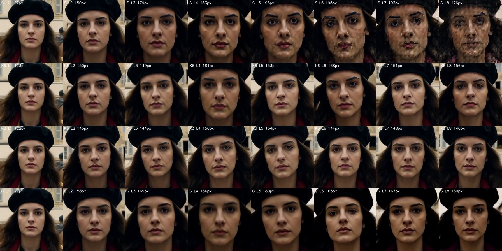

K3 loops (rows = phases A/B/C, columns = loops 1-8):
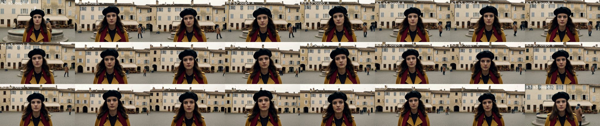

Metrics per loop:
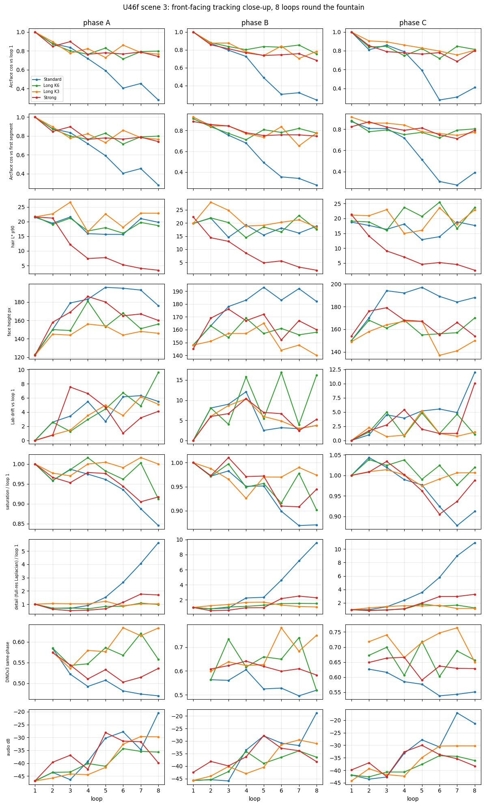

Side-by-side clip, loop 6 phase C (Standard left, Long K3 right; no audio): [extend_loop6_standard_vs_long_k3.mp4](../figures/clips/extend_loop6_standard_vs_long_k3.mp4)

Wall-clock for 24 segments: S 710 s, K6 590 s, K3 750 s, G 850 s (one cold start in the S figure).

## Caveats
One seed, one scene, 832x480, 24 segments; "very first frame" for ArcFace is clip 1's middle frame (frame 0 has a ~100 px face, too small); face height is the SAM mask box (hair and beret excluded); K3 is under 150 px in about a third of its clips (137-148); the camera moves so the background colour/DINOv3 numbers do not isolate drift (identity numbers do not suffer from this); ArcFace near 0.8 is "same" and is noisy per clip (n=3 per loop); hair L* is a 90th percentile and can be moved by the light; audio not listened to; K3/K6 anchors always fall on phase C. The fountain is mostly out of frame, so the stone/basin texture check of U46d is not repeated; skin texture on the face stands in for it (S mosaic at loop 5).


---

# U46e audio check: is Long K6's louder audio events or noise? (2026-11-04 23:50, CPU only)

## Verdict: mixed, mostly artifact. The extra loudness is a sustained harmonic drone, not prompt events.
- K6 loops 4-6 (segments 10-18) are 9 of 9 "drone" segments, and the level rise (-20 dB vs Standard -30..-44) is the drone. Drone = spectral flatness < 0.03 and centroid < 800 Hz. Count of drone segments out of 24: S 1, G 7, R (re-encode chain, known noise) 18, K3 6, K6 9, L3 16.
- It is not white noise, and neither is R's known noise: the spectrograms show a stack of sustained harmonics (about 200-1500 Hz, stepping between notes), the same texture as R's loops. It carries none of the prompt's events: no pigeon wing bursts, no bell partials with decay, no broadband water hiss (K6 centroid 560-690 Hz, fraction of energy above 4 kHz 0.003-0.009 vs Standard events 0.02-0.15).
- What survives on top of the drone are the footsteps: vertical clicks about every 0.5 s (K6 segs 10-13 throughout, 14 and 15 first half, 18 at the end). So K6 loops 4-6 are footsteps + drone, and the drone replaces the rest of the soundscape. G shows the drone too (7 of 24 segments) but quieter (-33 to -40 dB); S once (seg 22, in loop 8).
- K6 loops 7-8 recover to event-like audio (-47 and -38 dB, flatness 0.32-0.38, centroid 3.7-4.0 kHz), so the drone is episodic. It starts at segment 9-10 (~35-40 s), where the plain chain's picture starts to decay, and a re-anchor every 6th clip does not stop it in loops 4-6.
- The drone looks like an H3 audio failure mode of the latent carry, not something the re-anchor introduces: it also appears in S and G at lower level.

## Numbers (mean of the 3 segments per loop; scene 1; each cell = mean dB RMS / spectral flatness / spectral centroid Hz / crest factor dB; 24 kHz mono)
| loop | S | G | R (known noise) | K3 | K6 | L3 |
|---|---|---|---|---|---|---|
| 1 | -44 / 0.42 / 5178 / 26 | -45 / 0.42 / 5237 / 24 | -46 / 0.41 / 5091 / 21 | -43 / 0.42 / 5209 / 25 | -44 / 0.42 / 5178 / 26 | -44 / 0.42 / 5183 / 25 |
| 2 | -39 / 0.31 / 3834 / 27 | -44 / 0.38 / 4627 / 27 | -40 / 0.21 / 2680 / 21 | -42 / 0.38 / 4380 / 27 | -39 / 0.32 / 3880 / 27 | -41 / 0.34 / 3972 / 28 |
| 3 | -33 / 0.26 / 3705 / 28 | -40 / 0.26 / 3377 / 24 | -31 / 0.02 / 678 / 16 | -41 / 0.21 / 2972 / 21 | -34 / 0.20 / 2764 / 25 | -33 / 0.17 / 2463 / 23 |
| 4 | -32 / 0.33 / 3976 / 27 | -39 / 0.06 / 912 / 19 | -18 / 0.00 / 526 / 13 | -27 / 0.00 / 478 / 13 | -28 / 0.02 / 642 / 20 | -19 / 0.00 / 534 / 14 |
| 5 | -30 / 0.34 / 3817 / 26 | -40 / 0.04 / 819 / 16 | -14 / 0.00 / 625 / 10 | -30 / 0.15 / 1981 / 18 | -21 / 0.01 / 589 / 17 | -14 / 0.00 / 449 / 13 |
| 6 | -38 / 0.32 / 3655 / 28 | -33 / 0.01 / 533 / 17 | -14 / 0.00 / 583 / 10 | -36 / 0.36 / 4331 / 28 | -21 / 0.00 / 580 / 14 | -18 / 0.00 / 494 / 14 |
| 7 | -42 / 0.25 / 3085 / 26 | -45 / 0.23 / 2422 / 21 | -14 / 0.00 / 581 / 9 | -32 / 0.37 / 4323 / 29 | -47 / 0.38 / 3995 / 27 | -24 / 0.00 / 523 / 17 |
| 8 | -34 / 0.08 / 1315 / 25 | -48 / 0.40 / 4516 / 26 | -14 / 0.00 / 468 / 9 | -37 / 0.38 / 4497 / 28 | -38 / 0.32 / 3703 / 30 | -16 / 0.00 / 435 / 13 |

Event segments (S loops 1-3, K6 loops 1-2 and 7-8): flatness 0.2-0.4, centroid 3.0-5.2 kHz, crest 25-30 dB, band-to-band stationarity (correlation at lag 4 frames) 0.86-0.94. Drone segments (R loops 4-8, K6 loops 4-6, L3 loops 4-8, K3 loop 4): flatness 0.00-0.02, centroid 450-690 Hz, crest 9-20 dB (R 9-13, K6 13-20), stationarity 0.96-0.98. K6 loops 4-6 are in the drone class on flatness, centroid, HF fraction and stationarity. Their crest (14-20 dB vs R 9-13) and level std (6-9 dB vs R 3.5-4) are higher because the footstep clicks still ride on the drone. Onset counts (2-3 per s everywhere) separate nothing: footsteps and the drone's note steps both trigger them; not used.

## Spectrograms (same colour scale -110..-30 dB, log frequency; looked at)

K6 / S / R / K3, segments 12, 15, 18:
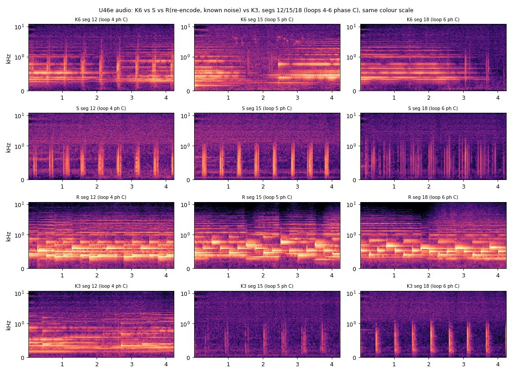

## Consequences for the Long method
- K6's audio at loops 4-6 is not better than Standard's: footsteps stay, pigeons, bell and water are replaced by a drone. K3 has it at loop 4 only (loops 5-8 mostly events again); L3 is drone from loop 4 to 8 (Late Lock is worst for audio as it is for the picture). In this seed K3 is the audio-safer re-anchor period.
- Standard's audio is clean until about segment 8; the drone onset coincides with the video texture decay. Re-anchoring the picture does not fix the audio. An audio-side repair (regenerate or replace the audio of drone segments, an audio re-anchor) is untested.
- Limits: no CLAP / PANNs / AST / BEATs on disk (none of CLAP, PANNs, AST, BEATs was installed), nothing downloaded, so nothing names the sound; the verdict rests on spectral features and reading the spectrograms. I cannot hear it. One seed, one scene.

## Timings and could-have-been-faster
About 12 min wall (reading 4, feature run 16 s, spectrograms 1 min, write-up 5). Faster: emit the spectrograms in the feature pass, and skip the onset counter (it separates nothing here).


# U46g - Long's audio drift (2026-11-05)

## Step 1: what the re-anchor does to the audio today (source read, no GPU)
Nodes: the Geiru context suite (Geiru Context Experimental, `hold_audio`; Keystone and Late Lock in its keyframe module).
- **Keystone/capstone is video-only.** The keyframe module never touches the audio part of the AV latent: the keystone is written into video latent 0 (locked), the capstone is tacked as an extra locked video latent on the back of the video for each model call and cut off the output again (`_tack_wrapper`: the audio part is repacked unchanged). So audio is neither re-anchored to clip 1 nor reset: it keeps being whatever Context made of it. The tack-on does give the model a video latent with no audio partner, and the front keystone is a clip-1 picture next to audio held from clip k-1's tail, so the audio sees a different picture than the one it was carried with.
- **Standard's audio carry (and K's, identical) is only the overlap.** Context with `hold_audio=True` copies the previous clip's audio latent for the 22 held frames (frames 22-44 of the tail window; 22 x 40/24 = ~37 audio steps = 0.9 s) into this clip's head and masks it as fixed. The remaining ~4 s of every 5.9 s clip is regenerated by the model, conditioned on the held 0.9 s of audio and the video. The kept audio of clip k is [22,124) frames; the 0.9 s that was held is dropped from the output and the clip before supplied it. So the carry chain is: clip k-1 tail audio -> clip k head -> everything the model makes after it.
- K3/K6 = Standard on all clips except every 3rd/6th, where `degradation_protection` is on and Keystone is wired; hold_audio stays True on those clips too. So the drone is a Standard failure mode (S had 1 drone segment, from seg 22) that Long's picture-side changes do not cure and may feed (K6 9/24, K3 6/24).
- Hypotheses to test: (1) the drone lives in the carried 0.9 s head (if so, a clip-1 audio head or no held audio resets it); (2) it is the model's own long-chain behaviour, in which case only hold_audio off (fresh audio each clip) or a seam/loudness fix helps.

## Arms
- K3 (existing baseline: picture re-anchored every 3rd clip, audio carried).
- A3: K3 + audio head re-anchored to clip 1's tail audio on every 3rd clip (extra Context from s1 for video+audio, then the normal Context from s(k-1) with hold_audio off so only the video is re-held from k-1).
- F3: K3 picture, hold_audio off on every clip (fresh audio per clip from the model and the video, no audio carry).
- R3: K3 picture, hold_audio off only on re-anchor clips (audio chain broken at each anchor).
Seeds and prompts identical to U46e scene 1 (47100+k) and U46f scene 3 (47300+k).

## Result (2026-11-05 00:32-01:49; 6 new renders of 24 segments, 12.3-12.5 min each)
**Verdict: the drone is the audio carry, not the picture re-anchor. Break the carry and it goes: every one of the three audio arms has 0-1 drone segments (K3 6, K6 9 on scene 1) with the same picture quality as K3. Ship Long as K3 with the audio chain cut at each re-anchor (R3) or the audio head re-anchored to clip 1 (A3); F3 (no audio carry at all) is the cleanest audio but is a bigger change.**
- Scene 1 (wide fountain, seed 47100+k): drone segments of 24: S 1, G 7, K6 9, K3 6, **A3 0, F3 0, R3 0**. Level loops 4-8: K6 -31 dB and K3 -32 vs A3 -39, F3 -43, R3 -42 (loops 1-3: -39..-43 for all). Spectrograms ([sheet 310](../figures/extend/310_u46g_s1_spectro_phaseA.jpg)); levels per segment: [sheet 314](../figures/extend/314_u46g_s1_levels.jpg): K3/K6 segs 10-16 are the stack of sustained harmonics with the footsteps riding on it; A3, F3, R3 at the same segments are footstep clicks over a dark floor, like S in loops 1-3. AST (AudioSet tagger, below) tags the drone segments "Music / Violin, fiddle / Sad music" at 0.4-0.6 (K3 seg 13: Music .60, Sad music .24, Violin .19), the clean ones "Knock / Walk, footsteps / Sound effect".
- Scene 3 (face loop, seed 47300+k): the drone shows up in S (6 segments, loops 5-8: -17 to -20 dB, flatness 0), G 3; K3 and K6 have 0 by the strict classifier but K6 gets loud and wide-band at loops 5-6 (K6 seg 13/16: blurred, dense, no clean footsteps) and K3 rises to -30 dB from loop 5. A3 / F3 / R3 stay at -40..-50 dB all 24 segments with clean footsteps. So scene 3 shows the same pattern, weaker.
- **What each arm does:** A3 (audio head of every 3rd clip = clip 1's tail audio, the video still from clip k-1): 0 and 1 drone, level -39 / -43, footsteps preserved; its seam steps stay as big as K3's (7.3 dB on scene 1) because the head is clip 1's audio, not k-1's. F3 (hold_audio off on every clip): cleanest level (-43 / -48), lowest seam steps (1.8 dB scene 1, 6.3 scene 3), but also the quietest and sparsest (footsteps and floor only; the pigeons/bell/water of the prompt are not richer than in the others); click metric is the highest on scene 3 (0.82, a hard sample step at some joins). R3 (hold_audio off only on re-anchor clips): drone-free, -42 / -45, seams in between (4.2 / 11.7).
- **Picture is unchanged by any of it** (same K3 picture, same seeds):
```
scene 1
arm | drone/24 | music-tag/24 | dB L1-3 | dB L4-8 | flat L4-8 | seam |dB| | detail L4-8 | detail L8 | lab L4-8 | arcface L4-8 | hair dL L4-8
S | 1 | 7 | -38 | -35 | 0.26 | 7.3 | 1.38 | 1.63 | 5.6 | 
G | 7 | 15 | -43 | -41 | 0.15 | 5.4 | 1.05 | 1.07 | 1.5 | 
K6 | 9 | 12 | -39 | -31 | 0.15 | 6.3 | 1.09 | 1.10 | 1.6 | 
K3 | 6 | 8 | -42 | -32 | 0.25 | 6.9 | 1.07 | 1.07 | 1.0 | 
A3 | 0 | 2 | -42 | -39 | 0.37 | 7.3 | 1.08 | 1.08 | 1.0 | 
F3 | 0 | 5 | -43 | -43 | 0.40 | 1.8 | 1.07 | 1.07 | 1.1 | 
R3 | 0 | 1 | -43 | -42 | 0.36 | 4.2 | 1.07 | 1.07 | 1.2 | 
scene 3
arm | drone/24 | music-tag/24 | dB L1-3 | dB L4-8 | flat L4-8 | seam |dB| | detail L4-8 | detail L8 | lab L4-8 | arcface L4-8 | hair dL L4-8
S | 6 | 8 | -45 | -28 | 0.15 | 19.4 | 4.84 | 8.74 | 8.1 | 0.46 | -2.7
G | 3 | 2 | -40 | -34 | 0.19 | 13.5 | 1.80 | 2.42 | 6.4 | 0.75 | -16.4
K6 | 0 | 4 | -44 | -37 | 0.21 | 15.8 | 1.26 | 1.25 | 7.8 | 0.80 | -0.9
K3 | 0 | 2 | -44 | -35 | 0.21 | 17.1 | 1.28 | 1.09 | 5.8 | 0.79 | -1.1
A3 | 1 | 5 | -44 | -43 | 0.20 | 10.2 | 1.26 | 1.17 | 5.4 | 0.82 | -0.7
F3 | 0 | 2 | -48 | -48 | 0.34 | 6.3 | 1.22 | 1.17 | 4.9 | 0.81 | +1.1
R3 | 0 | 1 | -44 | -45 | 0.31 | 11.7 | 1.31 | 1.41 | 5.3 | 0.78 | +1.7
```
  Detail ratios loops 4-8 are 1.07-1.08 (scene 1) and 1.22-1.31 (scene 3) for K3/A3/F3/R3, vs S 1.38 / 4.84; ArcFace 0.78-0.82 to loop 1 for all of K3/K6/A3/F3/R3 (S 0.46), hair dL within +-2 (G -16). Face crops 100% ([sheet 322](../figures/extend/322_u46g_faces_phaseA.jpg)-324, looked at phase A): A3, F3, R3 faces are the loop-1 woman through loop 8, no mosaic, same hair; S collapses at loop 6-8. Loop sheets for the new arms (looked at A3 and F3 scene 1): fountain, buildings and her coat stay the same in all 8 loops.
- Columns: dB = mean RMS of the segments (24 kHz mono); "music-tag" = AST top-3 label is a music/hum/instrument class at p >= 0.3 (crude, counts some real events: S loop 2-3 has 7); seam |dB| = mean absolute level step across the 23 joins (200 ms windows); detail = Laplacian variance of the 832x480 middle frame vs loop 1 same phase; lab = Lab drift of the same frame.

## Tagger
Downloaded MIT/ast-finetuned-audioset-10-10-0.4593 (model.safetensors only, 346 MB) and ran it on CPU on all 24 x 7 arms x 2 scenes segments. It agrees with the spectral classifier: the drone is tagged as music (violin / sad music / hum), the footsteps as "Walk, footsteps / Knock / Tap". So the drone is a spurious melody, not water or pigeons.

## Recommendation for what 'Long' should be
- **Period K3** (re-anchor every 3rd clip) as the default for anything with a person or a face; K6 only when cost matters and the scene is wide and static (K6 had 9/24 drone segments on the wide scene and a loud smeared loops 5-6 on the face scene, K3 6/24, so K6 is the worse of the two for audio as well as slightly worse on the face in U46f).
- **Audio handling: on every re-anchor clip, do not carry the previous clip's audio into the head** (R3: `hold_audio` off on those clips; the audio of the clip is generated fresh from the video and the prompt). It costs nothing, needs no new node, and removed the drone in both scenes with the picture unchanged. If a longer-than-2-min chain shows the drone returning between anchors (not tested: R3 was clean through 24 segments = 103 s), set hold_audio off on every clip (F3: cleanest audio, hard-sample steps at some joins) rather than adding anything. A3 (clip-1 audio head) works but needs a second Context node per anchor clip and gains nothing over R3.
- One-line description for a UI: "Long: the same picture fix as Strong's keystone every 3rd clip, plus a fresh soundtrack at each anchor; keeps the face and the sound for 2 minutes." (Standard's wording stays "good to ~40 s".)
- Code side (not touched here): the Long graph's Context node on `k % 3 == 0` clips gets hold_audio=False; nothing else changes.

## Timings and could-have-been-faster
Step 1 source read + graph wiring 20 min; batch 74 min GPU wall (6 x 12.3-12.5 min: A3 750/740 s, F3 750/740, R3 740/740); CPU analysis ran in the gaps (audio features and AST ~1 min per arm-scene, picture 20 s, ArcFace/SAM 1m47s for 7 arms after the restart, ~2 min); sheets and write-up ~25 min. Faster: scene 1 alone would have separated the arms (scene 3 added the face check, which only confirmed the picture is unchanged); R3 + F3 alone (skip A3, the costliest to wire) would have been enough; the feature script loaded AST even in the picture-only step.

## Open questions / caveats
One seed per scene, 24 segments (103 s); not listened to (spectral + AST + spectrograms only); scene 3's K3/K6 drone is only partly caught by the strict classifier; the three audio arms share segment 1 with the baselines and were not tested beyond 103 s; F3's audio is the sparsest, so the pigeon/bell/water events of the prompts are no more present there than elsewhere (no arm brings them back reliably: that is H3's soundscape behaviour; name discrete, countable sound events in the prompt).

