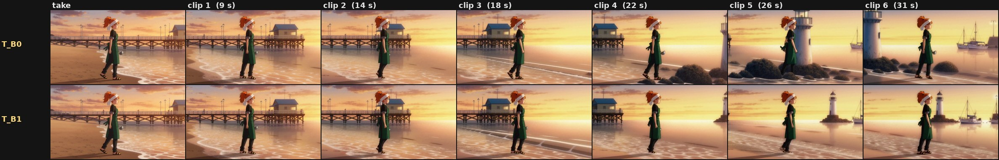
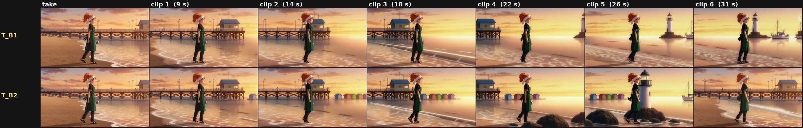

# U46h - rolling references in a long extend (2026-11-07, IN PROGRESS)

> **Status: in progress.** The GPU runs were still going when this was published (2026-11-07 ~21:30 EST). The fact check, feasibility, arms and the director design below are done; the measured verdict is not. The verdict goes in the "Verdict" section below when the lab finishes; nothing here should be read as a result until then.

Lab notes by Dylan (matlowai) and his Claude agents. Earlier extend studies (latent carry, re-anchors, audio): [u46_extend.md](u46_extend.md). The design this feeds: [world_state_design.md](world_state_design.md). Sources for the model facts: [factcheck_subject_vs_picture.md](factcheck_subject_vs_picture.md).

## Why

The latent carry from U46 holds the last 22 frames of the previous clip, so anything older drops out of context, and the "Long" re-anchor (U46e-g) only ever re-anchors to the first clip. Dylan's words:

- 2026-11-07 19:53: "there's the 'carry low drift forward' that works to some extent but earlier context drops out of context... so that's where rolling references getting added in with continuous shots help... we have a video continuation workflow but it's missing this important thing isn't it?"
- 2026-11-07 ~20:2x: "we need some kind of reference conditioning that changes as we go through and keep generating... we need the agent to be able to look at what generated in their latent-resolved pieces, which will let us know what parts of the latent context we need to wrap back into reference... for example there was a clown lady video walking down the beach and it was nice but eventually the landscape that rightfully drifted ends up reverting to the initial reference background conditioning... we need to agentically know what references are injected and change those as things evolve and continue over long horizons".

## Fact check first (checked against the model cards and the code)

1. **"FL2VA and Ref2VA are separate task-specialized checkpoints, with separate Pika adapters": TRUE.** The [MiniMaxAI/MiniMax-H3](https://huggingface.co/MiniMaxAI/MiniMax-H3) card: "MiniMax-H3 is released as two task-specific checkpoints": Base FL2VA (t2va + fl2va: "zero, one, or two input images") and Base Ref2VA (ref2va), each "a specialized Omni Transformer Model". [Pika-Labs/Pika-H3-Flex](https://huggingface.co/Pika-Labs/Pika-H3-Flex): two adapters, FL2VA ("text and endpoint-frame conditioning", on `transformer`) and Ref2VA ("multimodal references", on `transformer_ref`), "apply the matching Pika adapter". A typical extend graph runs the FL2VA pair with no pictures for every clip, a Ref2V take included, so "add pictures to today's extend graph" would put references on the wrong checkpoint. Every family-B arm here runs the Ref2VA pair; no FL2VA + Ref2VA-LoRA hybrid was run.
2. **"`<Subject N>` (reusable content) vs `<Picture N>` (a concrete frame)": TRUE in substance.** The card's structured prompt has `subject_definitions:`, `summary:`, `retention_analysis:`, `detailed_description:`; subjects are defined from the inputs ("<Subject 1> is the young man with short wavy blonde hair", "<Audio 2> is the voice timbre reference for <Subject 1>'s voice"), retention lines carry a status (`fully_preserved`, `partially_copy`, `reference`), and the I2VA example cites a picture as a frame ("at 0.00 seconds into the target video, <Picture 1> (from [Shot 1]) is fully referenced"). ComfyUI's text encoder only labels inputs as `<Picture i>` / `<Video k>` / `<Audio j>`; `<Subject N>` is a prompt-level name defined from them. **Family-B prompts here use the structured form: the Cast and the set are Subjects defined from their pictures; no standalone `<Picture N>` frame anchor (the carried frames are the opening).**
3. **Not documented anywhere:** continuation, extension or masked latents (neither card). The latent carry is community practice (seitanism's masked hold, the Geiru context suite) on FL2VA. Whether the Ref2VA checkpoint honours a masked carry is measured here, not assumed.
4. Limits (card, Ref2VA): up to 9 images, 3 videos and 3 audio (each 2-15 s, total up to 15 s), 12 files in all.

So U46h is split into two families that are never compared as if one option changed: **Family A, latent continuation on FL2VA** and **Family B, the same carry on Ref2VA with Subject references**. A-vs-B differences are checkpoint + adapter + prompt form + pictures together.

## Verdict

**Pending: the GPU runs had not finished when this was published.** This section will hold the measured answer per arm (identity vs the Cast, background vs the current place reference, whether departed landmarks stay gone and arriving ones arrive, colour and detail drift, seams, audio drone) and the defaults for the extend director in §6.

### First renders (by eye, not measured; travel scene, family B)

Clip (no audio), B0 on top, B2 below, 31.4 s: [rolling_refs_T_B0_vs_B2.mp4](../figures/clips/rolling_refs_T_B0_vs_B2.mp4)

What the strips show so far, with no numbers yet: in B0 and B1 the pier leaves and the rocks, lighthouse and harbour boats arrive in order. In B2, which cites a fixed picture of the take's own scene every clip, the pier is back behind her at clip 6 (31 s): the same kind of reversion to the starting background that Dylan described. One seed, one scene. Read the measured verdict before relying on this.

## 1. Feasibility (CPU, source read, graphs validated before any GPU)

- **Yes, one sampler takes both.** Core `MiniMaxH3ReferenceToVideo` returns the same empty AV latent as `MiniMaxH3ImageToVideo`, so Geiru Context writes the held latents and their zero mask into it exactly as it does for FL2V. The pictures do not touch the latent: they ride in the conditioning (`minimax_refs`), and the model packs them as their own condition rows between the text and the target (the packed layout takes both keyframes and references in one layout). The noise mask is applied per row (`denoise_mask` on the target rows only), so the held frames, the pictures and the free frames each keep their own role. Keystone/capstone (Long) is a model wrapper on the video target and is equally independent of the references.
- **Order:** loaders → Ref2V checkpoint + Pika Ref2V LoRA → `MiniMaxH3ReferenceToVideo` (pictures in socket order) → Geiru Context on its latent (previous clip = the sampler output before, head 39, drop_last 17) → (Long: Geiru Keystone) → BasicGuider (the Ref2V conditioning) → SamplerCustomAdvanced → decode → Seam Normalize on the 22 held frames → join.
- **The one conflict is in the words, not the graph:** a Ref2V take often cites an opening picture ("The shot opens on <Picture 1>"). In a continuation the carried 22 frames are the opening, so an opening citation must be dropped or it fights the carry (a second first frame). Cast and place pictures have no time position and do not conflict.
- **A Ref2V take's continuation usually switches checkpoint:** an extend tool built on FL2V keeps the take's own preset only for FL2V/T2V takes, so a Ref2V take is continued on a different checkpoint and LoRA from its first clip, with its pictures dropped. Arm A2 separates that from the pictures.

## 2. Unknowns (answered from the code)

- **Reference slots:** H3 Ref2V takes up to 9 pictures, 3 reference videos (2-15 s each, with their soundtracks) and 3 audio (core schema `ref_images` max 9, `ref_videos` 3, `ref_audios` 3). Each picture costs tokens on every step ("match" sizing = the render's pixel area: ~880 tokens at 1280x704 against ~28k for the 141-frame target).
- **Weights / ramps:** no per-picture weight in core. There is one knob for all condition rows together, `minimax_visual_cond_noise_aug` (default 0.999: the rows are near-clean; lower blends them with noise, i.e. weaker), set on the conditioning. A ramp over the denoise is possible without new code with two conditionings and `ConditioningSetTimestepRange` (pictures on for the first steps, off after, or the reverse); a per-picture ramp is not. Not measured here.
- **"Where" and "who" in separate pictures:** yes: each picture is its own block, named by its role sentence in the text ("Mio Hayase is <Picture 1>." / "<Picture 2> shows the place she is walking through now, not this shot's framing."). Swapping one picture leaves the others' tokens unchanged.
- **x0 previews:** pending (decode cost to be measured).

## 3. Arms and setup (2026-11-07 20:45 on, one RTX 5090)

- **Carry (both families):** the take's last 39 frames encoded once, then every clip carries the previous clip's sampler latent (Geiru Context, head 39, drop_last 17, hold_audio on, protection off), Seam Normalize on the 22 held frames, joins per the Geiru README (take 124 + 102 per clip + 119 last). The sampler latent goes between prompts as safetensors, so the carry is bit-exact with a one-graph extend and each clip can be looked at before the next is built. 6 clips per run = 31.4 s on the travel scene (5 clips = 27.1 s on L and M).
- **Family A** = FL2VA int8 convrot + Pika Flex FL2VA, continuation words only (beat rolled per clip). A1 Standard; A2 Long (keystone front + capstone back from the take's clip on every 3rd clip, hold_audio off there); A3 rolling keystone (the same, but the keystone/capstone come from the clip just before, i.e. an approved recent segment replaces clip 1 as the anchor); A4 selective re-anchor (A3's anchor only when a look check fires, computed from A1's own numbers).
- **Family B** = Ref2VA int8 convrot + Pika Flex Ref2VA, the official structured prompt (`subject_definitions` / `summary` / `retention_analysis` / `detailed_description`), no opening `<Picture N>` (the carried frames are the opening).
  - B0 no pictures;
  - B1 the Cast picture as `<Subject 1>` (`fully_preserved`);
  - B2 Cast + a fixed full-scene picture (the take's middle frame, person in it);
  - B2s Cast + a fixed set picture with the person removed (the pattern of Geiru's own clown example workflows, which run this exact carry on the Ref2VA checkpoint with a "`<Picture 2>` is the background only ... fully_preserved" picture every clip: the beach-walk video Dylan describes above);
  - B3 Cast + a rolling set picture: before each clip the newest kept frame is cleaned of the person (an image edit, 8 steps) and promoted only if a guard passes (no person left, same place as its frame, detail 0.5-2x, the source clip kept identity);
  - B4 agent-selected (costume scene: Cast + the place anchor fixed because the camera is locked, plus a "who now" crop of her after the costume change, promoted after a guard, Cast line switched to `partially_copy`).
- **Same in every arm:** seeds (scene seed + clip number), the take (a Ref2V take with plain `<Picture N>` wording), the per-clip beat text (where she is now / the current state; a departed landmark is never named again, see [prompt_craft_rules.md](prompt_craft_rules.md)), 1 clip = 141 frames, 6-step LCM Pika sigmas.
- **Scenes** (original characters Mio Hayase and Liora Venn):
  - **T travel** at 1280x704: Mio walks the beach in a side-on tracking shot; beats: pier → open sand + huts ahead → huts → rocks and tide pools → white lighthouse → harbour wall and boats. The pier must leave and stay gone, the lighthouse/harbour must arrive.
  - **L return** at 832x480: Liora practises wand forms on the roof terrace while the camera circles; the orrery leaves (clips 1-2) and must come back (clips 3 and 5).
  - **M state + costume** at 832x480: Mio at the ramen cart, locked camera; the bowl, once filled, stays full at the left end; the headband, once pulled off (clip 2), stays off.
  - L and M are at 832x480 because a 1280 clip costs 96-102 s here (59 s sampling + the text encoder and decode), against ~35 s at 832.
- **Measures:** SAM 3.1 person/face/hair/landmark masks; ArcFace IR101 + a DINOv3 character score vs the Cast; person-masked DINOv3 for the background; a copy score vs every cited picture; saturation, Lab, full-res detail, motion after 2.5 s, seams, dB, AudioSet tags and the drone flag from U46g.

## Lab traps so far

- **SAM 3.1 "face" finds a face on an empty plate:** a 1.0 x 0.47 box over the sky and pier of the cleaned beach, so the guard said "a person is still in the cleaned picture" and the fixed-set arm silently ran with no set picture. Fix: count only face boxes under 10% of the picture and lean on the person-mask fraction; a guard that refuses must show its numbers in the ledger (it did, which is how this was caught).
- **Frame caches keyed by run + clip name serve old frames after a re-render.** Key frames by the video file, not the run name.
- **A 1280x704 H3 clip costs 96-102 s on a 5090** (59 s sampling + text encoder + decode), not ~30 s at 832x480: budget lab grids from a measured first clip, and drop secondary scenes to 832 rather than dropping arms.

## 6. Design: the extend director (draft; defaults to be set from the verdict)

### References by role and lifetime

| Role | What it is | Lifetime | Where it comes from | In the prompt |
|---|---|---|---|---|
| who | a Cast picture (identity root) | permanent; never replaced by a generated frame | the Cast record | `<Subject 1> is <name>, the person shown in <Picture n>` + `fully_preserved` |
| who now | the person as she looks now (after a costume, wound, dirt change) | from the beat that changes her until the next change | a person crop of the newest kept frame that passes the guard | added to Subject 1's definition (`... and, as she looks now, in <Picture m>`), retention `partially_copy` naming what changed |
| look | the production style picture | permanent | the production's look | a Subject or the style line |
| where | the place | ROLLING when the camera travels (old ones retire); FIXED (an anchor) when the camera is locked or returns | a set plate, or the newest kept frame with the people removed (image edit, 7-10 s) | `<Subject k> is the place shown in <Picture n>` + `reference` |
| what | a prop or effect | only while the beat needs it | an effect reference / prop picture | a Subject while needed |
| just before | the last 22 frames | always | the latent carry (Geiru Context) | none (it is the opening) |

### The per-clip loop (look, decide, re-inject, ledger)

1. **Look** at the clip just made (decoded frames): SAM 3.1 person / face / named-prop masks; identity (character score vs the Cast; ArcFace as a number); background (person-masked DINOv3) vs the current place reference and vs the take; colour vs the look; people and prop counts vs the beat.
2. **Decide by intent** (the beat's camera/action words): travelling or circling → background change is expected → promote the newest clean frame as the place; locked-off → background change is drift → keep / re-inject the anchor; a costume/state beat → roll "who now" and the state text, never let an old reference restore the old state.
3. **Guard** before any promotion: no person left in a cleaned place picture; same place as its source frame (background similarity floor); detail ratio sane (no smear); the source clip passed the identity floor; counts match the beat. A failed guard keeps the previous reference and says why.
4. **Re-inject** the chosen pictures and roll the text: each clip's prompt describes where we are now and the current state, the same way for every arm.
5. **Ledger** per clip: every reference (slot, role, file, source take+frame, since which clip, why), what retired and why, the guard's numbers, the look's numbers, the prompt. A promotion is undoable from the ledger (re-run from that clip with the previous reference).

(To be completed with the measured defaults once the verdict is in.)
